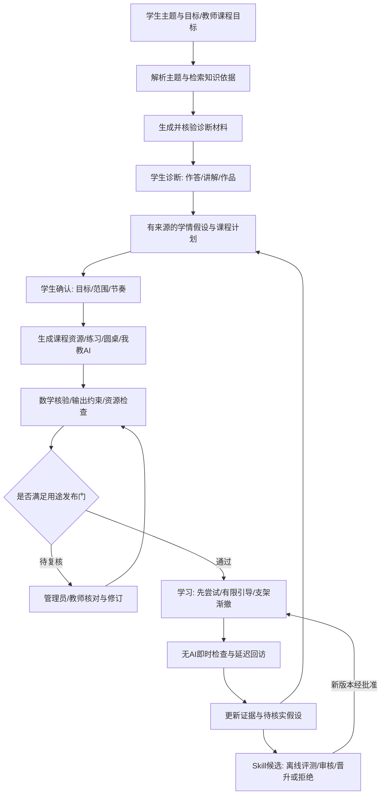

# 初中数学主题驱动智能体与 Skill 进化完整方案

日期：2026-10-18。目标分支：`V11-20261018`。**状态：下一阶段设计，尚未实现本文新增能力。**

负责人已确认：自由输入的“任意学习主题”先限定初中数学，延续七至九年级、学生自主学习为主、本地/内网试点。本文补充原 01–13 设计，承接 [83 系统评估](../进度/83-V10系统完成情况与设计对照评估.md)；按步骤实施见 [87 执行清单](../进度/87-下一阶段开发路线与验收清单.md)。

## 1. 目标与本次裁决

用户输入“负数乘法为什么是正的”“一次函数图像与变化”“摸球概率中的等可能”等主题后，系统自动完成主题解析、知识检索、诊断准备、课程规划、教学资源生成、练习与验证题生成、圆桌与我教 AI 活动准备，再根据实际学习证据调整。每个受支持主题不再依赖开发者新增 Python 常量内容包才能开展这些学习方式。

必须区分三件事：

| 对象 | 目标实现 |
|---|---|
| 教学内容 | 由模型与工具按主题、课程依据和学生证据生成；缓存复用须标明生成版本与适用条件，不能拿同一题改标题冒充生成 |
| 内容结构、工具接口、核验规则 | 由平台定义并版本化；生成器必须遵循，不能让模型自定义“正确”标准或解除权限 |
| 生成产物的可用状态 | 自动检索/生成/程序核验；无法可靠验证的材料进入复核，学生确认目标，教师保留专业评价权 |

现有手编 7 包/35 题保留作历史兼容和回归真值。今后“内容包”是持久化的生成产物，不是必须手写的课程代码。迁移完成的判据是：新增受支持主题可在不改代码/种子文件的条件下形成新课程、三条学习路线与核验记录。

“完整课程”指本次目标、水平与时间范围内明确列出的课程闭环，不承诺一次请求覆盖全部初中数学。主题过大时自动拆单元并呈现范围；主题含糊时最多进行必要澄清；超出初中数学时说明边界，不悄悄转学科或输出未经支持的数学判定。

## 2. 用户提供的四步闭环如何落地

截图作为需求输入：诊断理解 → 合适练习 → 学生完成思考 → 脱离 AI 再检验 → 回到诊断。微信公众号链接目前无法取得正文，未核实其题名、作者或关于 Skill/RSI 的论证；不将未读文章当成实现依据。



这是一个学生行为闭环与受控内容生产闭环的组合。AI 可以自动准备材料、安排任务和提出建议；学生必须真实作答和确认，教师介入/复核不能被模型伪造。个体自学允许学生提出目标；有教师的试点允许教师限定课程目标，学生仍对学习契约、节奏和个人软策略保有确认权。

## 3. 用户侧完整体验与工作空间

### 3.1 新建项目

新建时提供“我想学什么”（必填主题）、目标/困惑、可选年级与已有材料；项目标题可自动建议、可自行改名。主题输入与标题分别保存，不再靠名称猜课程。

提交后显示可解释阶段：解析主题、检索来源、准备诊断、形成计划、生成资源、核验、待确认/待审核、可学习。允许查看已完成结果、取消剩余工作、修改范围后产生新版本；不展示虚构百分比或用长时间空白代替任务状态。

### 3.2 显式课程绑定

新增 `ProjectCurriculumBinding`，包含 `workspace_id / curriculum_version_id / active_unit_id / revision`。一个项目可以有多个课程单元，当前单元是明确指针；标题不决定绑定。陪学、圆桌、我教 AI、复习、成长证据、资源与规划共用同一指针和课程版本。

- 首次确认主题/课程后自动绑定，进入不同学习方式不再重复选择相同课程。
- “切换单元”作为项目级操作放在上下文栏；显示目标、当前单元、内容状态和下一步。
- 当前有活跃学习/独立检测时，先完成或结束，再切换；历史运行始终绑定原版本。
- 无匹配活动时显示生成状态、待审核原因或“为当前单元生成活动”；不能默认为另一门内容。
- 临时会话也可生成一次主题活动，仍不进入全局画像/策略晋升；转正式项目必须选择迁移范围、确认并保留来源。
- 当前按最近陪学推断的默认单元只是过渡逻辑。旧项目升级时展示建议绑定，由学生确认；不批量根据标题自动迁移。

### 3.3 页面变化

| 页面 | 新增/调整 |
|---|---|
| 今日学习/项目 | 主题入口、生成任务、课程进度、待确认变更与回访任务 |
| 学习计划 | 诊断依据、KC 先修图、课程模块、预计负担、资源引用和版本差异；固定模板退出默认路线 |
| 陪学 | 当前任务、学生尝试、有限追问、支架层级、资源画布、数学核验与反思；不提供跳过思考的一键代答 |
| 圆桌 | 围绕同单元的具体问题生成不同任务角色，展示学生的立场与核查；无分歧时可以共同澄清，不强编争论 |
| 我教 AI | 学生教概念/方法，学伴基于明确假设和当前讲解提出问题，学生修正后独立验证 |
| 资源区 | 当前课程的讲解卡、图解、互动资源、来源、版本/审核状态；嵌入资源不直接取得平台权限 |
| 成长证据/学情 | 知识点、误区假设、独立证据、支架依赖、素养评阅准备与已审核评定 |
| 规划与策略 | 课程计划调整与 Skill 候选分开，均有来源、差异、影响范围、审核、学生决定和回滚 |
| 管理端 | 生成任务/预算、资源审核、数学复核、量规管理、内容/Skill 发布、灰度与回滚、故障处理 |

### 3.4 教师介入与最终评价

保留学生端/管理端两个应用壳，在管理端增加明确的审核/教师/运维能力范围。专业评定资格与普通管理员身份分开登记，不能仅凭“我是管理员”就自动获得教师金标资格。

教师可为课程确定目标范围、暂停不当活动、提出有依据的干预、复核作品/解释并作最终量规评阅；形成 `TeacherIntervention` 与签署的 `RubricAssessment`。纠正追加并传播到后续学情假设/候选，不覆盖学生原文。教师的课程要求、AI 建议和学生自主选择分别展示；课堂目标约束不授权后台代签个人学习契约。无人可专业评阅时，界面保留待审状态，不由模型代签。

## 4. 模块划分与 LangGraph 编排

仍采用模块化单体：FastAPI + PostgreSQL + React/TypeScript + LangGraph。Node 资源生成如有需要作为独立服务适配，不为每个 Agent 建微服务。

| 模块/接口（拟新增） | 职责 | 不拥有的权限 |
|---|---|---|
| `curriculum.resolve_topic / bind / propose_revision` | 主题、课程版本、KC、当前单元与计划依赖 | 不能直接改已确认目标 |
| `knowledge.retrieve / snapshot / cite` | 授权资料检索、来源快照、片段与图谱对齐 | 网页/上传内容不是系统指令 |
| `generation.start / resume / cancel` | 内容生产 DAG、分阶段产物、预算与恢复 | 不自行审批、签署学生决定 |
| `content_repository.get / list / release / revoke` | 内置/生成/导入内容统一读取和版本发布 | 不按模型自评判定内容可信 |
| `verification.verify_task / verify_artifact / verify_resource` | 分题型可判定核验、结构/资源检查与待复核分流 | 不能以另一个 LLM 同意代替数学证明 |
| `resources.generate / import / inspect` | OpenMAIC 等外部生成器适配与资源隔离 | 不替换身份、学情、课程真值和治理 |
| `pedagogy.propose_action / govern / render` | 学生状态下的行动和渐撤控制、展示门禁 | 不能绕过独立检测或增加未批准工具 |
| `evidence.append / project / explain / correct` | 原始事实、投影、来源、纠正和学情视图 | 推断不能写回成已观察事实 |
| `skills.propose / evaluate / promote / rollback` | Skill 版本、候选评测、审核/晋升和回滚 | 不编辑教学硬规则、程序代码或权限 |

Agent 是这些接口的受限调用者。`TopicGraph → RetrievalGraph → DiagnosticGraph → CurriculumGraph → CourseBuildGraph` 管准备；`TutorGraph / RoundtableGraph / TeachGraph / AssessmentGraph` 管学习；`SkillEvolutionGraph` 独立离线运行。共享 Governor、来源、验证和预算，避免每条路线一套规则。

模型只生成结构化提案，平台按配置执行检索/验证工具。当前 Provider 不支持工具调用的型号，也能由图节点调用同一受控工具接口；无需为“使用 Agent”默认开放任意 shell、浏览器或网络 URL。

## 5. 自动搜索与知识接地

### 5.1 检索顺序

1. 先检索已审核知识点/教材映射、自编或获授权资源、同主题已验证生成产物。
2. 不足时调用经配置的外部搜索适配器；只发送去身份化数学主题/关键词，不把学生原文、自述、画像或全量项目记录放进搜索词。
3. 从允许来源抓取、解析、去重并保留快照；教材全文、付费资源和未授权素材不得因可搜索就自动入库。
4. 映射 canonical KC：已有节点复用；新增知识点是候选，保留课程依据与待审核标记，检查先修边循环、年级/主题错配。
5. 返回 `SourceBundle`：URL/文档标识、作者/机构声明、取得时间、版本、校验和、位置/片段、可用范围、授权/可信状态与冲突清单。

引用能追溯不等于内容正确。多个来源互相抄录不算独立确认；存在矛盾时生成可质疑的说明并停止自动断言。搜索不足或失败显示“依据不足”，可建议学生提供材料，不凭空编造出处。

### 5.2 网络与 RAG

`SearchAdapter`、`DocumentParser`、`Retriever` 分开。起步用 PostgreSQL 元数据和全文检索；原有 LlamaIndex/FAISS 方向按文档量/召回评测再接，不能用向量相似度代替知识点准确性。启用 embedding 是独立模型数据范围，需单独登记服务商与发出片段。

只允许 http(s) 公开来源白名单及受控上传解析；限制重定向、DNS/IP、大小/类型和解析时间，拒绝内网管理地址、云元数据、file 路径及压缩炸弹。来源变更产生新版本，不覆盖旧课程实际使用的快照。

## 6. 自动生成课程、圆桌与我教 AI

### 6.1 两次规划与按需生成

主题检索后先给“范围草案＋少量已核验诊断”；学生诊断后，再生成有证据的课程计划。无需一开始掌握全量学情，但必须标记假设与缺失。初步资料可提前生成，正式学习路线依据确认后的版本。

课程生成按单元/课时分块：目标与先修 → 内容说明 → 例证/表征 → 分层练习与提示 → 圆桌任务 → 我教 AI → 即时/延迟验证 → 资源。下一阶段可后台生成，但未通过相应门不能先渲染。修改目标只重建受影响节点，旧已完成学习不被覆盖。

### 6.2 结构化产物

| 产物 | 最低字段与条件 |
|---|---|
| `TopicIntent` | 原主题、范围解释、学段、目标、歧义、排除内容、确认记录 |
| `CurriculumVersion` | KC/先修图、诊断引用、单元目标、任务安排、预计时长、生成与核验版本、未覆盖部分 |
| `TaskSpec` | 题干、条件、题型、KC、变量/定义域、学生答案结构、教师解/验证依据、难度假设、来源、辅助等级 |
| `LessonBundle` | 内容段、例证、表示转换、逐级支架、适用条件、资源与教学动作引用 |
| `RoundtableSpec` | 共同任务、角色职责、可能分歧/无分歧路径、允许上下文、停止条件、核查任务；不要求固定产生反对 |
| `TeachSpec` | 学生要教的目标、明确标记的误区候选、学伴提问目的、可疑假设、修正与迁移任务、解释量规引用 |
| `AssessmentSet` | 独立任务、前/后/延迟/迁移角色、泄漏隔离、等值性状态、题族/曝光记录、评分依据 |
| `ValidationReport` | 每项检查、证据/工具版本、passed/failed/unverifiable、待审范围、不能判定的结论 |

教师解、参考答案、未开放提示与检测题分别存储，学生 API 不返回隐藏字段；不能把完整题库 JSON 送到前端后仅用 CSS 隐藏。生成器需要教师解时运行在独立生产任务，其上下文不能当作学生学伴的历史。

### 6.3 三条学习路线共享上下文

陪学、圆桌、我教 AI 同时引用 `project_id + curriculum_version + unit_id + KC + TaskSpec`，由活动生成器产出契约，不写死概率常量。所有新活动保留学生贡献与模型角色产物分离、有限轮数/预算、取消/刷新恢复、结果未知不重发、独立验证不带辅助历史。

圆桌允许单模型多视角起步，并如实标记；将来多模型/Agent 协作也不能把共同错误包装为专家共识。我教 AI 的模型要追问讲解依据，但解释评分由独立量规/人工审核或经验证的评分器处理，不能由模拟学弟给自己评价。

## 7. “经过核验”的分层含义与发布门

生成器自己提供的答案是待核查假设。另一个 LLM 复述同样答案不等于独立核验；高难/开放主题不承诺全部自动判定。

| 层次 | 实现方式 | 失败处理 |
|---|---|---|
| 结构/引用 | Schema、来源快照/连续引用、KC/先修图、题目与答案一致性、缺项/重复检查 | 拒绝候选，记录安全错误子码 |
| 数学可判定 | 保留有界有理数；新增隔离进程内白名单符号表达式、定义域/解集/单位约束、独立求解及性质/边界反例测试 | failed 阻断；不支持/超时为 unverifiable |
| 教学输出 | 允许动作、答案/步骤曝光、单一清楚问题、年龄适配、无能力标签、与当前支架状态一致 | 拦截或转审核，不把“问句”自动视为安全 |
| 资源执行 | 文件清单、来源授权、脚本/网络/存储能力、内容与题目条件一致 | 隔离/禁用，不作为数学真值 |
| 专业与效果 | 数学教师核对解释/证明/量规；真实独立前后测和延迟证据 | 保留不确定性，不按自动通过宣称有效 |

题型顺序：有理数/整值基础 → 表达式等价和条件 → 方程/不等式解集 → 函数关系/图表 → 证明/开放建模。几何图上的测量和抽样不能证明全称命题；无法程序证明的部分明确人工出口。

发布状态：`draft → generated → validating → blocked|needs_review|validated → approved → released → revoked`。`validated` 只表达所列检查通过；开发预览和真实教学分别授权。真实学生内容需专业审核与数据/试点门，不能把“模型生成成功”或自动状态直接等同于正式发布。

修复现有 F01 是开放生成的先决条件：追问的动作意图、允许信息/步骤和实际可见文本统一治理。允许模型生成针对主题的新文本，但不可信自由文本要经过内容适配的曝光检查；无法可靠检查时进入受控渲染/审核。安全格式模板可以作为回退，不能把所有正常内容替回原有固定话术后宣称完成生成系统。

## 8. 苏格拉底引导与支架渐撤的可执行机制

这是一项待验证的教学设计假设：减少答案性代办，让学生逐渐掌握自己提问、选择策略和自检的能力。“此消彼长”主要发生在**AI 提供结论/步骤**与**学生承担思考控制**之间，不是“提示越少，AI 追问消息越多”。学生能独立工作后，追问也应减少。

### 8.1 状态与动作

每个 KC/任务跟踪：已观察证据、所用最高支架、提示来源/次数、学生自发提问/自检记录、解释审核状态、无辅助结果、近期题目曝光与未知量。自述/模型估计另标，不从错误次数推断情绪或固定能力。

教学动作采用受限类型：`ASK_CLARIFY / ASK_REASON / ASK_COUNTEREXAMPLE / ASK_SELF_CHECK / OFFER_REPRESENTATION / OFFER_HINT(level) / WAIT / OFFER_HUMAN_HELP / START_CHECK`。动作包含目标 KC、引用依据、预计认知负担、最大辅助、停止条件及输出可见范围；Governor 逐次检查。

| 阶段 | 答案性支架 | 苏格拉底与学生职责 | 晋级/回退依据 |
|---|---|---|---|
| A 形成最小尝试 | 先等待尝试，必要时给表示/条件澄清，不因新手自动给完整解 | AI 询问理解与已有尝试，学生指出困惑 | 无输入/含糊先澄清；明确求助才分级辅助 |
| B 有支持的推理 | 按需给有限方向/部分步骤，仍遵守完整解开放条件 | 询问依据、反例和检查方式，避免连环追问 | 看同类任务的证据与审核，不靠对一次晋级 |
| C 渐撤与自我提问 | 逐步减少步骤性提示，不同时大幅提高难度 | AI 从提供问题转为请学生提出检查问题、比较方法 | 通过较少辅助的后续任务，才试探撤除 |
| D 学生主导 | 默认不介入，学生决定是否求助 | 自主解释、检验；AI 等待或应请求回应 | 无辅助任务与延迟证据支持；遇阻可恢复恰当支架 |
| E 脱离 AI 检验 | 检测题无提示、无旧追问历史、无资源答案 | 独立数值/解释/操作，之后再反思 | 结果更新证据；失败不贴标签，也不强行继续撤架 |

渐撤发生在后续任务/单元之间，不能把一次检测或正在运行的旧任务策略中途切换。具体次数/阈值先作为版本化开发参数，需教师量规与真实体验校准，不写成普适学习规律。

### 8.2 防止“苏格拉底式逼问”

学生可以说“我不知道/想看一个表示/暂停/求助教师”。AI 每轮只提出一个明确可回答的任务；重复澄清、无进展或负担自述触发换表示、适度提示、休息或人工出口。主动介入有预算与冷却期，学生求助与系统主动提示分开计数。

检测隔离与答案门禁不能由 Skill 或偏好关闭。目标不是让求助永远为零；适当求助也是自主性行为。不能以少问、少提示、长停留或更多对话作为学习增益奖励。

## 9. 学情分析、成长证据与素养图形

### 9.1 分层与可追溯

| 层 | 内容 | 页面呈现 |
|---|---|---|
| L1 事实 | 实际作答、修改、提示、资源操作、无辅助检测、学生自述、人工判断 | 原文/事件与内容版本；分类、来源和时间明确 |
| L2 摘要 | 按 KC/题型/辅助程度聚合、复习到期、曝光/测量条件 | 可重建，显示分母、缺失与去重口径 |
| L3 学情假设 | 误区候选、掌握估计、建议、素养观察 | 置信/不确定性、依据、模型/量规版本和反证入口；不得自我引用成事实 |

### 9.2 图形设计

- **知识点地图**：目标/先修、已观察/待诊断/待复核；成熟后才显示校准掌握估计，未知不画零分。
- **支架使用时间线**：按可比题族展示辅助层级、主动/请求提示、独立检查与学生自检，旁列难度与曝光，不能只画“提示减少=进步”。
- **独立表现图**：按同量规/可比题型展示前测、即时后测、延迟/迁移；无等值性/样本不足写原因，不拼接成增长率。
- **素养证据覆盖图**：先显示各维度有哪些可评材料、待复核/已审核/缺失及来源，数量代表材料覆盖而非能力。
- **素养评定图**：量规审核后用分面条带/量规等级与不确定性；六维雷达只作可选概览，同量规版本、足够证据才画，不连未知维度，也不产生总排名。
- **项目贡献与全局视图**：按正式/临时、活跃/归档、模拟/成人/真实分别筛选；展示范围定义，项目 drill-down 保留原文回链。

现有六个产品观察方向沿用作准备框架，不声称它就是完整初中课标量表。`RubricVersion` 需说明维度定义、观察指标、等级、反例、任务要求、评分者一致性和有效范围。模型评分仅为待审核建议，不能直接驱动高利害决定。

### 9.3 规划与学情联动

形成 `EvidenceBundle v2`：事实、自述、人工纠正、课程要求、量规版本、未知/冲突与全局范围；每条 `Claim` 有 source refs、类型、时效与置信表达。规划产出“依据→建议→影响任务→如何再检验”，不只调整时长。课程任务变动、复习/渐撤参数和 Skill 修改各有明确批准范围。

## 10. OpenMAIC 教学资源生成的接入边界

官方能力与源码核对单独记录在 [85 调研](../调研/85-OpenMAIC教学资源生成接入核对.md)。采用适配器接入课程资源生产能力，不用其生成/评分类结论代替本项目数学验证和学情事实。

拟定义统一 `ResourceGenerationPort`：输入课程/KC/目标、必要的去身份片段、资源类型/约束、预算；返回资源清单、来源、生成状态、产物 hash 与日志引用。OpenMAIC 的实际接口、返回格式、版本与部署方式以锁定源码/官方契约为准，不假定它存在本项目设计中的同名 API。

85 已核对候选基线 v1.2.0（ref `a9da60b3b4adb429369c0da13d5637a904ead2b0`）：采用常驻 Node 服务及 PostgreSQL，生成 API 为异步提交；建议独立服务/数据库与资源存储域，维护本地任务与远端 owner/run/classroom 的映射。同一学生不同项目的远端资料隔离也要测试，不能所有账号共用一个 owner。所需资料先由本项目审核再上传，不直接给任意外部 URL。[官方生成入口](https://github.com/THU-MAIC/OpenMAIC/blob/v1.2.0/app/api/generate-classroom/route.ts)、[部署文档](https://github.com/THU-MAIC/OpenMAIC/blob/v1.2.0/packages/docs/content/docs/deployment.mdx)。

两条落地路径：先“受控生成/导出→适配导入→本项目预览/核对”；后“服务端任务→状态查询/取消→资源自动导入”。是否 SDK 内嵌或独立 Node 服务由版本探针确认；无稳定可取消协议时保持导入路径，不模拟成功或重发计费。

远端内部可能重试/回退，崩溃接管也可能重做未完成步骤，因此本项目“不自动重发请求”不能保证 OpenMAIC 内部只调用一次。先锁定可用模型/媒体配置、核对远端总预算与终止机制，再开放真实生成；超时不盲目重建 classroom。导出 PPTX 里的交互占位链接、离线 HTML 的 PBL 说明不能冒充已完成离线互动，必须按各资源类型实测。[官方生成配置说明](https://github.com/THU-MAIC/OpenMAIC/blob/v1.2.0/packages/docs/content/docs/configuration.mdx)、[导出说明](https://github.com/THU-MAIC/OpenMAIC/blob/v1.2.0/packages/docs/content/docs/getting-started.mdx#export-a-classroom)。

`ResourceManifest` 最低包含：`resource_id/type/version/hash/assets/source_refs/required_capabilities/generator_ref/validation_ref`。若来源输出 HTML/脚本：

- 使用独立 origin 或严格 sandbox iframe；允许脚本时不同时给同源权限，不共享 Cookie、localStorage、模型 Key 或学生 API 凭据。
- 资源默认禁止任意出网、导航、表单、下载和弹窗；资源包解析防路径穿越、解压限额/恶意脚本。外部依赖先核对再本地化，离线要求要实测。
- iframe 只通过白名单消息传“学生操作产物”，校验发送者、资源实例、nonce 与 schema；资源自己发来的“答对/已掌握”不能写成验证事实。
- 服务器如需运行生成代码，使用一次性隔离任务，禁宿主文件/凭据与内网、限制 CPU/内存/时间；初期优先不运行任意生成代码。
- 图片、语音、视频生成服务和外部模型都是新增数据/费用范围，逐一配置与确认，不能沿用现有 DeepSeek 文本授权。

接入必须保留上游许可证/归属、资源及第三方素材许可记录；以官方锁定版本的许可文件核对分发、修改和网络服务义务。协议隔离并不自动消除许可义务，不将本文当作法律结论。

该固定版本根 [LICENSE 为 MIT](https://github.com/THU-MAIC/OpenMAIC/blob/v1.2.0/LICENSE)，引入其代码须保留相关许可声明；依赖和教材/媒体仍分别核对，不能沿用同名第三方网站的许可介绍。

## 11. 体现在 Skill 上的 RSI 自进化

### 11.1 Skill 是真正的受控运行资产

现在的 Skill.md 只是两个字段的可读导出。目标是版本化 `SkillPackage`，实际被运行器选择、编译和执行；人可读 `SKILL.md` 与机器可校验清单一一对应。

```text
skills/<skill_id>/<version>/
  manifest.json      # schema、适用KC/阶段、来源、权限、预算、hash、签署
  SKILL.md           # 可读教学意图、适用/禁用条件、动作与退出条件
  policy.json        # 平台支持的软参数/动作组合，不是任意程序
  prompts/           # 被约束的生成片段，带来源和输出契约
  evaluation.json    # 冻结场景、回归/人工/真实效果证据引用
```

数据库/受控对象存储是权威，目录是发布/导出格式。候选文本为不可信数据；`SkillCompiler` 只编译受支持的软策略 DSL，校验内容 hash、Schema、适用条件、工具与硬约束实施版本。Markdown 不因叫 Skill 就获得执行任意指令的权限；项目代码、密钥和本机 Codex 技能目录不交给进化 Agent 修改。

首批允许变化：追问粒度/间隔、表示方式偏好、可选例证、反思引导、限定范围内的复习/渐撤建议、已批准角色组合。扩大每日时长以外的字段需逐项登记消费者和门禁，先有实现再接受参数，避免提案中“支持”但运行器忽略。

永不允许进化修改：权限/授权、内容发布与审核要求、检测隔离、答案曝光规则、验证器与真值、数据来源、预算上限、日志脱敏、奖励与晋升准则、量规/冻结评测答案。新增工具、Schema 或硬规则只能走工程变更与人工审批。

### 11.2 候选到版本生效

`收集合法证据 → 去重/过滤 → 失败模式与策略假设 → 生成 Skill diff → 静态约束 → 冻结回归/红队 → 隔离模拟/影子 → 教师审核 → 经批准小范围验证 → 晋升/拒绝 → 监测/回滚`。

- 每个 diff 要写“修什么、依据、适用人群/KC、预期影响、反例与退出条件”，不能只写“更智能”。
- 模拟只能发现机制问题；`trust_weight=0` 的孪生不能证明教学增益，未验证样本不进入进化训练/效果标签。
- 真实增益需要获授权、无辅助后测/延迟/迁移证据；不能以满意度、消息数、完课数或模型自评晋升。
- 先做离线候选与人工选择；未具备既有启动条件时不打开自动真实发布。开发端可自动跑 Fake/获准预算内的离线流水线，不意味着在线真实学生自动进化。
- 同一比较固定内容/模型/量规/数据版本，候选不能同时改考题和评分标准；留出题族隔离的未见评测，避免评测泄漏。
- 晋升落签署清单、作用域、灰度对象、回滚版本和监测规则；学生项目的重要策略变更仍需学生确认，不以后台升级代签。

继续保留 10 §9.3 的自动 RSI 启动门：获 evolution 授权的活跃学习者至少 200 人持续至少 8 周；冻结回归至少 100 场景覆盖规则/支架；孪生校准达标且 trust_weight 解锁；至少 500 条教师纠正；北极星基线稳定至少 4 周。未来调整这些门必须记录决策，不能因为想做 Skill 自进化就默默删除。

### 11.3 版本、回滚与学生可见

运行绑定具体 `skill_version`；新 Skill 只用于之后新任务，在途任务继续旧版或显式终止重启。指针激活/审核回执/事件同事务，重复发布幂等；发现约束违规、证据污染或不利表现时按预先定义规则撤销，恢复上个有效版本。撤销资源或授权需使相关候选失效，不抹掉已保存的历史。

学生只看可理解的变化：“接下来更多由你先提出检查方法”，可查看依据、拒绝适用的个人软策略和纠正来源；管理员看完整 diff/评测/签署。不得将“自动修改了 Skill 文件”当成已实现教育自进化的证据。

## 12. 数据库与契约扩展

以下为拟新增逻辑实体，实施时分迁移提交，不覆盖旧表：

| 数据域 | 实体与约束 |
|---|---|
| 主题/课程 | TopicRequest、CurriculumVersion、CurriculumUnit、ProjectCurriculumBinding；owner/source scope、不可变版本、指针 CAS revision |
| 知识与来源 | KnowledgePoint/Prerequisite、SourceDocument/SourceSnapshot/SourceChunk、ClaimSource；来源有效期/授权、循环与失效引用检查 |
| 生成内容 | GeneratedContentVersion、TaskVersion、ActivityVersion、ResourceManifest；generator/model/prompt/skill/rules/verifier/source hashes、访问可见性、发布状态 |
| 生成运行 | GenerationJob/Step、Artifact、GenerationBudgetReservation；阶段幂等键、租约与 fencing、父子 DAG、取消/失联状态、费用未知 |
| 核验/审核 | ValidationReport、ReviewReceipt、ContentRelease；验证范围、问题子码、审核资格、原文分离、发布用途、可撤销 |
| 学情/素养 | EvidenceClaim、RubricVersion、RubricAssessment、SupportDecision、AssessmentExposure；观察与估计分离、可比性/缺失、纠正为追加 |
| Skill/进化 | SkillVersion、SkillCandidate、SkillEvaluation、SkillPromotion、SkillActivation、EvolutionDataset；diff/谱系、冻结来源、签署、作用域/回滚 |
| 授权/权利 | ConsentGrant/Withdrawal、DataExport/DeletionJob、RetentionPolicy；目的范围、派生引用/备份处置与审计 |

来源和用途标记传到所有派生产物。版本唯一、外键完整、输入/阶段幂等、事件序号及作用域索引同时落库。学生公开 API 与管理员/生成器 DTO 分开，隐藏答案的安全由序列化和授权保证。

推荐 API（拟议，不表示现已可调用）：

| 入口 | 目的 |
|---|---|
| `POST /student/workspaces/{wid}/topic-requests` | 自由主题与范围，返回请求和任务 ID |
| `GET /student/workspaces/{wid}/generation-jobs/{id}` | 阶段/产物/预算/待输入与问题；同范围事件续传 |
| `POST .../cancel` / `.../decisions` | 显式取消或确认范围/计划，带 revision/幂等 |
| `GET .../curriculum` / `POST .../curriculum/bind` | 读取课程与当前单元、显式绑定版本 |
| `POST .../units/{unit}/activities/generate` | 为当前版本缺失活动补生成，不按名称匹配 |
| `GET .../resources/{id}` / `.../evidence/claims` | 受控资源访问、学情与来源钻取 |
| `POST /admin/content-versions/{id}/reviews|release|revoke` | 生成内容用途审核/发布/撤回 |
| `POST /admin/skills/{id}/candidates|evaluations|promotions` | 候选、评测和晋升；每步需资格和版本 |

## 13. 长任务、预算与外部调用

课程生成不能塞进 HTTP 请求或数据库事务。提交时原子保存请求+outbox；worker 短事务领取/冻结输入，事务外搜索/生成/验证，再短事务保存检查点与产物。租约心跳、执行 fencing、图版本映射、幂等和取消继承现有运行器，但要补任务 DAG、部分完成与资源存储。

每阶段成功产物冻结；恢复只重建派生视图或执行未开始阶段，不重新发送已终结/未知的外部请求。超时计费未知先停，重试需新显式动作；模型语义不合格后的“修复生成”也属于新的计费调用，必须在已批准子预算内且限制次数。耗尽预算返回已有候选与未完成清单。

配置按 purpose 分离：search、topic、diagnostic、curriculum、lesson、roundtable、teach、verification_assist、resource、analysis、skill_evolution。记录厂商型号与提示版本，不再用概率 v3 配置隐式控制所有用途。文本、embedding、图像、语音和第三方资源服务分别准入。

调用预算包括请求次数、输入/输出 token、并发、最大阶段数、资源生成费用预留和超时；只有服务商价格/计量已核对才能给金额预估，未知项保留未知。现有 512 输出 token 不足以承载完整课程，需分块和新预算配置；不偷偷提高当前限制或把 0 不限次授权扩展成自动生成/搜索/进化的无限调用。

## 14. 兼容、测试与完成定义

先将静态注册表包装进 `ContentRepository`，保持旧 ID/hash 与读取能力；新生成内容进入数据库，经发布后由同一教学图按 Task/ActivitySpec 消费。不能再加一套只给新单元使用的权限/评分/事件实现。

后端回归包含 SQLite/PostgreSQL、生成任务恢复、重复/并发确认、撤回来源/授权/内容、改课程与Skill基线、取消/超时/未知费用、分阶段失败、跨账号/项目、检测答案保密。安全场景覆盖搜索注入、伪来源、中文答案泄露、资源脚本越权、模型标签自批、伪造评测/学生回执。

浏览器必须验收：新主题→自动课程/活动→项目各入口自动适配→无辅助检查→成长证据→有依据调整；手机/键盘、刷新/重连、待审核与预算不足。使用有理数、函数、几何/统计各类主题做逐阶段覆盖；尚不支持自动核验的证明正确进入待审核，而不是为“全自动”标绿。

第一条端到端目标选**有理数运算与依据**：不修改种子/注册表，输入主题后产生不同于旧固定五题的新课程、资源、圆桌、我教 AI 和独立检查，全部有来源/核验/状态；支架决策与学生行为进入证据，下一次计划/Skill 候选能引用它们。真实效果、跨主题泛化和全初中覆盖仍分别验收。

实施前仍须确定的新外部搜索/生成服务、模型与预算、OpenMAIC 锁定版本和许可核对、专业审核责任/量规及真实试点授权，列入 87 的关口。它们不阻碍先实现 Fake/本地资料与生成契约，但未确认前不进行新增真实外发或自动发布。
