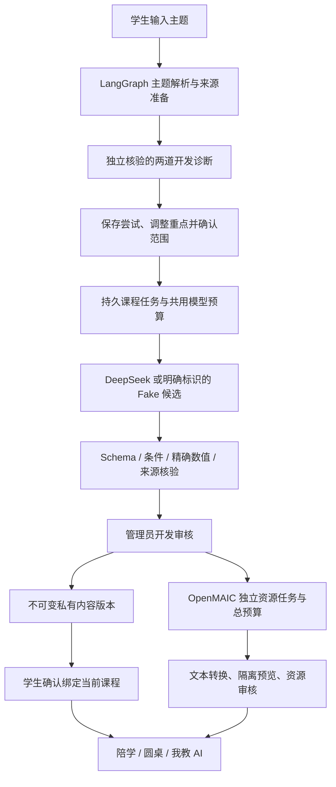

# G02–G05：主题课程、互动与资源实现边界

> 后续补充：Tavily真实检索与一门OpenMAIC文本课堂已按用户确认范围验收，OpenMAIC已切换独立Docker容器；正文canvas转换/SSE/无模型只读重导入见 [95号记录](../进度/95-G02G05外部真实接入验收.md)。本文下方未确认/本机Node描述保留首轮实现时口径。

日期：2026-10-18；开发版本 `0.15.0`；数据库 `g05_002`。基于 86/87 号设计推进；历史方案保留原状态，本文件记录这次实际实现。

## 1. 当前交付及完成界限

| 阶段 | 已实现 | 尚未达到完整设计的部分 |
|---|---|---|
| G02 | 自由主题输入、开发 KC/先修映射、歧义澄清、范围拒绝、本地来源登记/去重/冲突标记/版本/撤回；Tavily Basic 适配与持久任务 | 真实搜索需确认服务范围、配置本机密钥后验收；六个开发 KC 不是完整七至九年级课标图谱；不自动判定资料观点冲突 |
| G03 | 诊断→观察计数→学习重点修订→学生确认→模型候选→独立数学编译核验→开发审核→项目课程绑定；真实 DeepSeek 已验证 | 不是任意数学题型的课程生成器；大单元拆成多课时、解释质量、专业教师审核、等值诊断与自动误区归因待完善 |
| G04 | 生成课程同步产生陪学/圆桌/我教 AI；统一内容与当前项目；通用模型方向选择；渐撤/恢复支架、私有活动验证题、展示曝光记录 | 自由模型追问暂未开放；角色文字由受限模板渲染；不是独立专家；无真实学生教学效果、迁移或素养结论；新题族延迟测验待补 |
| G05 | 固定 OpenMAIC 部署、异步适配、独立预算代理、课堂 ZIP 导入、隔离文本卡与审核、学生沙箱预览 | 本机服务健康检查通过；真实课堂生成待预算确认；首期只转换文本，图片/音视频/任意交互脚本关闭；不承诺完整还原原课堂 |

因此不能把本次交付写成“初中数学任意主题整套课程、资源、学情和 RSI 已全部完成”。G06–G09 仍按原计划推进。

## 2. 模块与调用顺序

- `app/modules/knowledge`：标准 KC、合法本地资料、快照和 Tavily 发现。
- `app/modules/generation`：课程状态机、参数化数学编译、通用互动意图。
- `app/modules/resources`：远端异步端口、受限模型代理、导出包转换与安全渲染。
- `learning/ContentRepository`：共享旧内容与项目私有新内容；私有课程不能跨项目复制调用。
- `model_tasks` 与教学 worker：复用预算预约、冻结输入、短事务、租约与完成结果门禁；HTTP 在事务外执行。
- `gateway/generation.py`：新增双端 API；`/internal/openmaic/v1` 仅接受服务私有凭据。
- React 新增学生 `/student/courses`、管理员 `/admin/generation`，沿用项目上下文。

## 3. 内容如何自动生成与核验

模型不再只从旧 `seeds` 选择一个预定义单元。每次课程请求生成新的标题、目标、讲解、真实来源引用和七组题目参数/参考值，编译器产生新的内容版本、题目、分级支架与两个活动。

题目采用受限数学结构。模型可以选择参数，不能任意修改题干条件后仍沿用旧参考值。独立程序用 `Fraction` 与整数平方根核对精确结果及适用条件；不使用 `eval` 或任意代码执行。

| 题族 | 自动核验范围 |
|---|---|
| 有理数 | `a ÷ b + c`，除数非零 |
| 一元一次方程 | `ax+b=c`，一次项系数非零，有理数解 |
| 一次函数 | `y=ax+b` 的给定自变量求值，`a≠0` |
| 勾股计算 | 已给两直角边求有理数斜边；正边长与直角条件显式存在 |
| 等可能概率 | 等机会摸球的有利数/总数，条件显式存在 |
| 统计 | 算术平均数；中位数等不能自动替换成平均数任务 |

候选顺序为一诊断、两练习、两陪学检测、两活动私有验证。生成前的两道诊断另行取样并排除参数重叠。课程总体五题，两个活动的私有验证题不进入普通课程目录，防止先在陪学中做过再当活动新题。

独立数值核验不等于教材核验、证明有效性或讲解质量审核。管理员核对后发布的仍是开发内容；`real_student` 账号不可使用。模型不能自行批准课程。

## 4. 知识来源及外部搜索

内置六个 KC 文本是自编开发依据，不冒充课标、教材或教师结论。管理员可登记全局或特定项目的已授权来源；正文、版本不可覆盖，状态可撤回。新版本另登记，旧快照不自动换成新正文。

本地检索按 KC 与工作空间过滤，规范化正文精确去重，最多五份。`conflicts_with` 可显式阻止冲突来源继续生成；没有声称用语义模型自动识别所有资料冲突。

Tavily 只接收规范数学关键词，固定 Basic、最多五条、两次/主题、二十次/站/日。只允许 `moe.gov.cn`、`pep.com.cn`、`zxx.edu.cn` 及其子域的 HTTPS 发现结果；拒绝伪后缀、身份信息 URL、其他端口与私网位置。用户填的 locator 只是记录，不触发 URL 抓取。

搜索结果固定 `discovery_only`，不得直接进入已授权课程依据。管理员核对授权、登记资料后，新课程准备才会使用。网站可访问不等于允许抓取或再利用。

撤回/版本不符会阻止诊断继续、课程生成/审核/激活、模型完成结果应用及资源展示；冻结学生原始尝试仍保留。

## 5. 互动、渐撤与证据

通用模型只输出本轮连续原文引用和 `clarify/basis/representation/verification/compare` 意图。平台渲染有限问题，中文数词、伪问句或任意自由步骤不会直接出现在角色发言中。圆桌是同一模型选择方向后的三种视角，不假装三位独立专家一致。

当新生成课程已经出现一次未请求提示的练习数值通过，后续练习第一次求助先邀请学生提出检查问题；仍困难时再次求助可恢复具体支架。该决定只依据本轮过程，不生成掌握或能力判断。四级支持上限和主动跳过/结束保留。

`AssessmentExposure` 在诊断/检测展示时追加，不等学生答题才记录。取消后重进的同题标记 `seen_before`，互动验证不计独立新题；旧事实也参加曝光判断。不能追踪平台外看过答案的情况。

L1 事实保留支架决定、提示、原始表达、数值状态和检测曝光；原题延迟复习继续使用现有复习模块。题族等值性、真正未见延迟/迁移测试以及素养量规留在 G06 及后续阶段，不能用原题复做证明迁移。

## 6. 任务、故障与预算

- 课程状态涵盖澄清/范围外/缺资料/资料冲突/诊断/计划确认/排队/待审/已发布/失败/未知/取消/退回。
- 同一来源、模型配置与课程版本冻结。取消、归档、停用或来源撤回后，迟到结果不应用。
- 生成和互动使用已有 `ModelDailyBudget`，不创建新测试库规避真实日额度。每课程最多六次，确定的内容拒绝最多一次手动修复；未知结果不能修复重发。
- 课程单次最多 4096 输出 tokens；互动最多 512，通用每活动最多三次。当前一次课程整包生成通常只用一次调用，不刻意用满六次。
- 新课程候选使用 Provider 的 JSON object 模式，并继续执行本地 Schema/数学核验。JSON 合法不能代替内容正确。
- 搜索失败仍占预约次数，未知结果不自动重试；资源内层重试仍受代理次数与累计 token 限制。
- 模型错误只返回安全错误码，候选拒绝增加有限原因码；不把原始凭据、上游错误或学生原文放日志。

## 7. OpenMAIC 隔离

固定 `THU-MAIC/OpenMAIC v1.2.0`，提交 `a9da60b3b4adb429369c0da13d5637a904ead2b0`，保留 MIT 许可。本轮 Docker Hub 连接失败，改用已验证的本机 Node24 运行服务与独立 Docker PostgreSQL；只监听 `127.0.0.1:4004`。

OpenMAIC 获取本机服务代理的随机私有凭据，拿不到 DeepSeek 密钥。固定补丁保护数据 API 和非 GET/HEAD 写操作；浏览器不持有服务凭据。worker 用每个任务独立随机 owner cookie，不能使用学生账号或工作空间 UUID 替代。

首轮建议预算：一门、三场景、仅文本，最多二十请求/次4096输出，累计输入128000、输出32768 tokens。仍待本轮用户确认，数据库当前没有开放预算记录。已批准的普通课程调用不能自动扩展为 OpenMAIC 费用授权。

202 只表示排队；按固定端点轮询 jobId，完成后按同 owner 读取课堂文档。提交崩溃/超时且不知道远端 ID 时保留 unknown，不盲创建第二个付费任务。当前没有自动找回所有“提交成功但未存 ID”的远端已完成任务；需受控人工核对，不能把它标成可自动恢复。

ZIP 最大5MB、500文件、展开总量20MB；检查目录穿越、符号链接、加密等，不实际解包执行。资源转成文本卡，HTML 转义、iframe 空 sandbox、CSP 禁止网络/脚本/表单。产物自身评分不写学习事实。取消会停后续模型调用及本地发布；不能保证远端在途费用为零。
