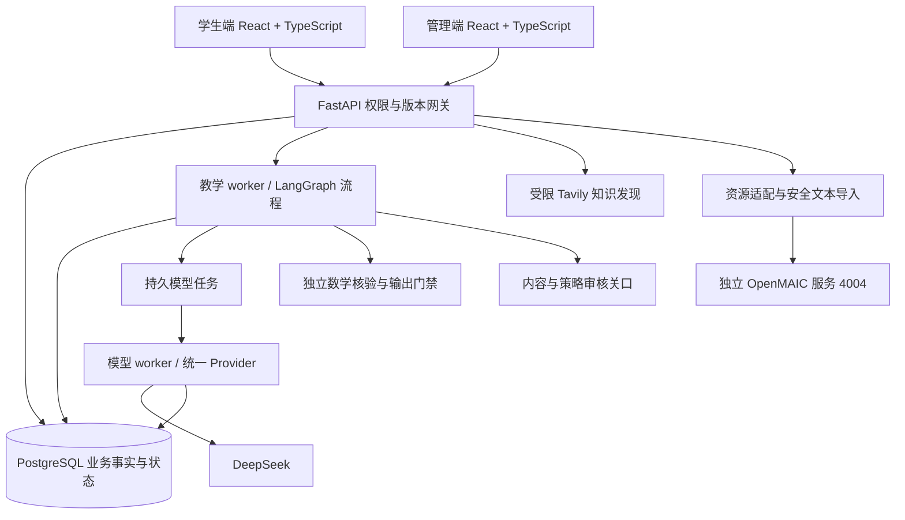

# 桂子问津 V12：开发进度与功能实现介绍

**汇报日期：2026-10-19；内容截止：2026-10-18。** 代码交付分支 `V12-20261018`；应用版本 0.18.0，数据库 `g08_001`。本文介绍已实现能力、实现方式和验证边界，不把设计目标写成完成成果。

## 1. 产品要解决什么问题

桂子问津面向初中数学自主学习，帮助学生围绕一个目标持续学习、表达和检查理解。它把“做题与对话”变成有项目归属、有过程证据、能调整教学策略的学习闭环。

设计方向覆盖七至九年级常见数学单元，优先按课标知识点组织，后续再映射教材。当前是本地/内网的模拟与成人开发验证版，尚不是完整教材平台，也未面向真实学生正式教学开放。

最初目标为：诊断当前理解 → 安排合适练习 → 保留学生思考 → 脱离 AI 再检验 → 根据证据调整。当前已完成这个闭环的首轮工程骨架；课程完整性、解释评阅和真实学习效果仍需要后续建设。

## 2. 一分钟汇报摘要

> 我们已从前端演示推进到有数据库、真实接口和异步任务的可运行系统，学生端和管理端独立。学生可以建立项目，确认课程与计划，进行陪学、复习、圆桌讨论和“我教 AI”，再查看可追溯的成长证据。部分路线已接入 DeepSeek，支持主题课程候选生成、独立数学核验和人工审核；外部检索与一门 OpenMAIC 文本课堂也已完成真实接入验证。
>
> 最近的重点是让证据真正影响后续教学：四类受限策略已接入实际任务；系统还能根据结构化记录提出一个 Skill 改进假设，运行新旧机制评测，经人工审核和学生确认再生效。当前这种改进仍是本机规则驱动，评测证明工程机制可运行，不证明教学收益。下一阶段将扩展题族和专业评阅，补充语义候选与更严格测验，然后准备小范围试点。

## 3. 学生与管理员各能做什么

| 功能 | 使用者看到什么 | 主要实现方式 | 当前边界 |
|---|---|---|---|
| 账号与独立双端 | 管理员创建学生账号，双端各自登录 | 角色认证、持久会话、服务端权限检查 | 本机首管理员初始化；尚未对接学校身份系统 |
| 项目与临时会话 | 创建、切换、重命名、归档、恢复 | 账号/空间所有权、版本和状态校验 | 临时会话不自动进入正式项目长期画像 |
| 主题与课程 | 输入主题、诊断、确认范围、等待生成和审核、确认使用 | 主题解析、知识来源、LangGraph 任务、Provider、课程版本注册 | 六类开发题族；不支持主题会澄清/拒绝，不承诺任意主题完整生成 |
| 学习计划 | 填目标和时间，确认后开始 | 持久化流程关口、异步 worker、幂等提交 | 固定计划草案与模型课程/策略路线是不同功能 |
| 津津陪学 | 诊断、练习、提示、反思、检测 | TutorGraph、题目阶段、支持状态、独立数值核验 | 数值正确不等于解释正确；模型展示仍受控 |
| 圆桌讨论 | 先表达，再比较视角、修正并验证 | ActivityGraph、同一模型的不同视角、学生贡献分开存储 | 不是多位教师或独立专家投票，观点仍需核对 |
| 我教 AI | 学生讲解，AI 选择针对性追问方向，修正后做另一题 | 多轮活动状态、有限上下文、受限意图展示、独立核验 | 通用活动最多三轮；尚不能自动评定长篇讲解质量 |
| 错题与复习 | 错题、不可验证答案、复做和学习记忆 | 不可变事实、来源索引、默认 1/3/7 天安排、原题复做 | 原题复做不是未见题迁移；间隔未经过真实学生校准 |
| 成长证据 | 全局/项目、趋势、知识点卡、支架时间线、素养材料条形 | 事实聚合、来源/日期/归档筛选、点击钻取原始记录 | 六个开发 KC，六方向材料均未评定，不给能力分 |
| 规划与策略 | 结合体验、项目证据和参考资料提出策略，查看/导出 Skill | 冻结来源、受限候选、Skill Markdown 与类型化配置编译 | 真实规划模型目前只建议时长/反思；四项执行参数可手动提出 |
| Skill 离线改进 | 生成改进假设、查看 diff 和新旧评测、采纳为待审策略 | SkillEvolutionGraph、结构化规则、冻结语料、实际消费者评测 | 单参数变化、本机规则驱动；无教学收益结论、无自动真实发布 |
| 课程和资源治理 | 审核候选、撤回来源、导入安全文本课堂 | 版本/来源门禁、独立核验、沙箱预览、人工回执 | 开发审核不代替数学专业审核 |
| 运行和评测管理 | 看队列、任务状态、取消、用量、版本对照与逐条复核 | 长任务运行器、调用账本、事件/审计、冻结评测报告 | 上游未知结果不盲目重试，实际金额以服务商账单为准 |

## 4. 智能体如何工作

### 4.1 从主题到可学习课程

1. 输入主题，解析到明确知识点；含糊或范围外先澄清。
2. 读取已登记且允许使用的知识资料。Tavily 只在允许站点发现资料，搜索结果不会自动成为授权教材。
3. 保存诊断和范围，交给模型生成课程候选与活动结构。
4. 用独立核验器检查可计算答案和题目条件；不合格的内容拦截，明确失败候选最多按规则修复一次。
5. 管理员核对并发布开发版本，学生再次确认使用；课程归属当前空间。
6. 陪学、圆桌和我教 AI 共用该课程版本，避免通过项目名称猜测教学内容。

当前自动生成覆盖：有理数混合计算、一次方程、一次函数求值、勾股数值、等可能概率、平均数。已有七个静态开发单元共 35 题仍保留，作为可重复基线；它们不是整套七至九年级题库。

### 4.2 模型与数学核验分工

模型承担候选内容、追问方向和受限建议。程序承担运行权限、阶段隔离、类型/引用检查、可支持范围内的数学答案核验，以及持久化与审计。人工承担开发内容复核与策略发布判断。

G00 后，未核验的自由模型文字不能直接作为完整教学结论展示：模型选意图，界面采用受控的提问表达。这样保留针对性方向，同时限制答案泄露与不受控输出。长篇解释的语义正确性和教学适切性仍需专门评阅。

### 4.3 苏格拉底引导与支架渐撤

目标是把直接步骤支持逐步转为学生自问、自检。生成课程可采用“先自问，可恢复支持”：已有无提示数值通过后，后续练习先引导提出自己的检查问题；学生仍可求助，恢复具体支持。

支架多少和追问方向是两条受限策略轴，可分别控制并记录。它们不是简单线性地“提示越少越好、问题越多越好”；学生遇到困难时必须允许恢复。独立检测阶段不提供提示或资源；曝光过的同题不能再次当作首次独立表现。

### 4.4 从成长证据到 Skill 改进

事实、自述、人工数值复核分别存储，图形点击可回到来源。规划提案冻结当时依据，避免后来新增记录改变旧提案的含义。

四类实际执行参数为：练习原序/错题优先、复习按到期/到期错题优先、生成课程逐级支持/先自问可恢复支持、通用追问检查依据/表示/核验。Skill.md 是这些配置的可读产物；类型化配置与 Markdown 同源编译并校验指纹，不把任意 Markdown 指令直接执行。

G08 根据同项目同内容的错误、求助和人工数值纠正，提出一个白名单参数变化。新旧策略运行冻结工程样本和真实消费者，检查排序、支持、追问与隔离行为。随后先经改进评测复核，学生才可采纳为普通提案；普通提案仍需管理员审核和学生确认。新任务冻结策略，旧任务不随回滚改变。

**目前不是自动教学自进化**：候选来自规则，不自动理解学生正文；四个工程样本采用脚本答案验证机制，`learning_gain` 为空，自动真实发布关闭。

## 5. 技术架构与模块职责

| 层 | 目录/技术 | 职责 |
|---|---|---|
| 双端与共享组件 | `frontend/apps`、`frontend/packages` | 两套入口，共享接口类型和基础 UI |
| API | `app/gateway`、FastAPI | 身份、所有权、请求校验、状态与版本冲突 |
| 教学/规划/进化 | `app/modules/learning`、`planning`、`skill_evolution`，LangGraph | 可恢复流程、学生确认、策略与运行快照 |
| 知识/生成/资源 | `knowledge`、`generation`、`resources` | 来源、课程版本、生成审核、外部适配 |
| 证据与记忆 | `evidence`、`memory` | 原始事实、派生观察、来源追溯与冻结摘要 |
| 基础设施 | SQLAlchemy/Alembic、PostgreSQL、worker | 迁移、事务、幂等、租约、恢复、备份 |
| 模型 | `app/llm/provider.py`、模型任务运行器 | 统一调用、超时、取消边界、用量与未知状态 |

框架选择为 LangGraph 编排，按需使用 LangChain 适配。当前核心通过自有 Provider 接入 DeepSeek、Fake 和兼容接口能力；管理页面已开放 DeepSeek/Fake，不能据此宣称所有常见厂商均已接通验收。

## 6. 哪些已做真实调用，哪些只是本机验证

| 路线 | 已有证据 | 不能推导的结论 |
|---|---|---|
| DeepSeek 陪学、我教 AI、圆桌、规划及主题课程 | 历史真实开发调用与逐条评阅/核验记录 | 不等于稳定适用于真实未成年人或所有数学主题 |
| Tavily | 一次真实检索，1 credit，返回 2 条 PEP 结果，相关性不完全一致 | 不等于知识库完整或搜索正文已获授权 |
| OpenMAIC v1.2.0 | 独立 Docker，一门三场景文本课堂；8 次模型请求，输入 42,450、输出 6,181 tokens | 不包含图片、语音、视频及真实教学效果；首轮预算已停止 |
| G06 / G07 | 过程图形与实际策略消费者的本机回归/浏览器验证 | 不代表素养已测量或策略已提升成绩 |
| G08 | 规则候选、冻结机制评测、审核/采纳/撤回完整本机闭环 | 不是真实模型语义 RSI 或真实收益实验 |

真实外部验收见[95号记录](../进度/95-G02G05外部真实接入验收.md)。外部调用次数按各次独立记录解释，不将历史批次重复相加。

## 7. 验证完成到什么程度

- G07 选定回归批次：112 项通过；相关浏览器批次 6 项通过。
- G08 最新选定回归批次：98 项通过，覆盖 SQLite/PostgreSQL 隔离数据；相关浏览器批次 6 项通过；类型、生产构建、接口生成类型和离线分发包检查通过。
- 两批测试范围不同、有重叠，不能相加成总数；98 也不是全仓所有测试总数。
- 最新数据库前向升级、备份归档检查与关键历史表数量核对完成，主服务及新增页面可访问；G08 未新增真实模型调用。

可追溯依据：[G07验收](../进度/99-G07四类策略执行验收.md)、[G08验收](../进度/101-G08离线候选与评测验收.md)。这些是相应阶段已记录的验收，本次文档整理不冒充再次执行全部测试。

## 8. 明天建议怎么演示（约 8–10 分钟）

1. **项目与上下文（1分钟）**：学生端选择已有正式项目，展示课程绑定，说明项目名称不决定课程。
2. **课程与活动（3分钟）**：使用已审核课程演示一个练习/求助和已保存的圆桌/我教 AI 过程。检测答案独立核验，三种视角不当成专家共识。
3. **成长证据（2分钟）**：切换全局/局部，点击一条图形来源，展示原始作答和自述分离；素养材料不展示为分数。
4. **策略执行（1分钟）**：展示已生效策略和某任务冻结快照，解释仅影响后续新任务、可回滚。
5. **Skill 改进（2分钟）**：如已有符合条件候选，展示 diff、冻结报告及管理复核；没有候选时使用文档解释流程，不临时伪造学生效果。
6. **边界与下一步（1分钟）**：先深化内容和评阅，再建设专业量规与资源，最后准备 G09 小范围试点。

演示前核对 Docker、4003 API、teaching/models worker 和所用账号权限。优先用已有已审核资料与记录，避免现场等待付费生成。已有 OpenMAIC 资源可读，不重新预约；需要现场新增付费任务时先确认已发布配置和现有授权范围。详见[完整使用手册](../使用手册/14-V12完整使用说明书_学生端与管理端.md)。

## 9. 当前不足与下一阶段

| 不足 | 后续工作 |
|---|---|
| 六个开发 KC 与完整初中数学差距大 | 扩展内容台账、题族、先修映射和专业审核 |
| 受限模板不能完成开放语义教学 | 冻结多轮评阅、分离数值与解释检查、逐项开放 |
| 素养展示只是候选材料覆盖 | 制定专业量规、评阅一致性与适用边界 |
| Skill 进化仍为规则与四样本工程评测 | 授权后增加语义候选和更大冻结样本，保留审核 |
| 缺少真实效果与运营证据 | 无辅助/延迟/迁移评价，权限/数据制度、恢复和并发演练，小范围试点 |

详细实现顺序、验收标准和需要确认的事项见[下一步完善计划](../进度/102-V12下一步完善与验收计划.md)。结论：已形成可演示、可追溯的智能体教学工程闭环，距离完整课程、专业教学评价及经过验证的自进化产品仍有明确工作量。
