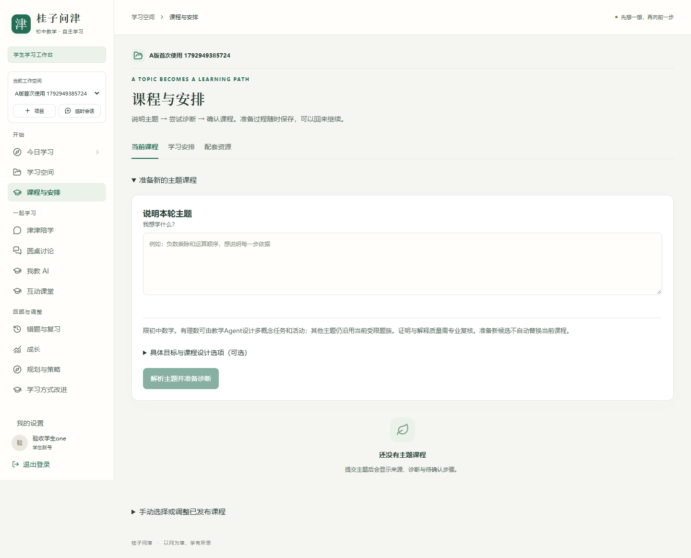
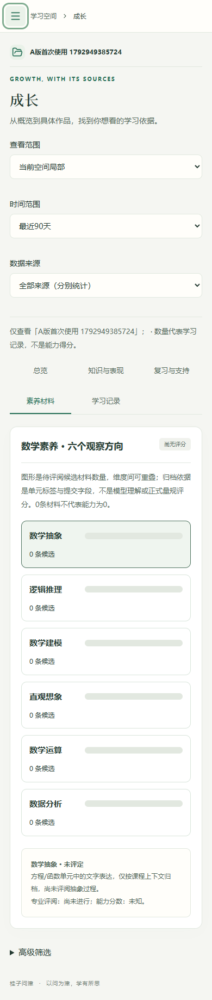

# V17-debug 整改实施与验收

日期：2026-10-26。开发分支：`V17-20261025-debug`。设计依据：[120号方案](120-V17-debug问题清单与修改方案_20261025.md)，采用 A 版。API 仍为 `0.20.0`，数据库仍为 `r14_003`，本轮无需结构迁移；学生端与管理端继续独立，主服务固定端口 4003。

## 1. 本次交付

将 A 版的信息层级接入真实 React 页面和现有接口，没有将 HTML 原型的固定数据、对话、进度或管理表格复制到正式系统。

- 学生导航分为开始、一起学习、回顾与调整；陪学、圆桌、我教 AI、互动课堂保留直接入口，设置移到账号区。
- 课程页分当前课程、学习安排、配套资源。未绑定先显示主题输入；已绑定先显示真实下一步和当前课程，新主题准备按需展开。计划和单元库的旧路由继续可达。
- 成长页改为总览、知识与表现、复习与支持、素养材料、学习记录五类，只加载并展示当前分类。记录支持服务端日期筛选、分页和原文追溯。
- 陪学合并为一个主要输入区，保留作答、回应追问、反思、提示、停止生成与结束陪学。跨三类教学活动前先恢复原任务或明确结束；查看复习、规划和回滚不被整体拦住。
- 管理导航按教学支持、内容与质量、平台管理分组，保留原有工具名称。概览新增真实队列的最近一页待办，不冒充全站总量。

新版操作见 [18号使用说明](../使用手册/18-V17-debug新版布局与操作说明.md)。

## 2. 对照问题台账

| 问题 | 已实施内容与可核对结果 | 边界 |
| --- | --- | --- |
| B01 引号与答案绕过 | 只有真实学生原文中的引用可豁免；新增数字解法、变量赋值、完整数值步骤和理由夹答案被拦截。问句、观点、调度理由、历史渲染及后续调度消费共同检查 | 自由语言的检查采用保守契约，可能拒绝合法表达；不是任意中文的无泄题证明 |
| B02 数学概念错误 | 当前题族的不变量反例集；未核验数学陈述不直接作为追问前提，无法确认时保留备用中性引导。观察性调度理由与问句语法分开 | 数值仍由独立程序核验；不自动评定解释、证明、素养或教学效果 |
| B03 可用性与次数 | 服务端给出活动剩余、每日剩余、处理中或耗尽原因；固定耗尽不标记可反复重试。提示和作答保持独立可用 | 余额可能随并发预约变化；不限每日次数不取消活动内限制 |
| B04 跨功能答案理解 | 复习复用陪学的保守解释器，支持“这个答案是6”；否定、多候选仍为未确定，保留原文 | 复杂单位、含糊自然语言及证明仍需另行评阅 |
| B05 旧单元混入 | 当前目标只使用当前内容版本、同来源的有界事实，历史背景另组，保留时间和版本。规划模型只取当前版本原文；RSI原有同版本约束保留 | 全局计数不是当前课程掌握证据；旧记录仍可追溯 |
| B06 主题与教学执行 | 区分不支持和需澄清；安排使用已确认课程、同来源困难记录、到期复习及时长。确认计划的优先任务实际进入下一次陪学冻结顺序，其他练习和检测保留。变式/选题/反思/资源建议记录执行或待用户行动状态 | 仅支持已实现题族；时长为建议；资源建议不冒充已经阅读或生成 |
| B07 RSI 验证平台 | 冻结策略摘要、题集及内容版本；测验前固定被试分配；采集核对实际策略、练习暴露及严格先后。报告按完成全阶段的同一被试统计样本门槛；新个人试用登记三次新鲜无辅助检测失败的保守停止规则 | 仅工程验证平台，真实教学效果仍待验证；停止不意味着已证明因果负效应；旧试用不追改停止协议 |
| B08 配音与诊断 | 保存安全阶段、HTTP状态、请求编号；拒绝与结果未知区分，下载和格式校验分开。账单待对账与请求结果不混淆。单独一次配音授权有数据库防重、单槽位和金额限制；已有课堂按可用素材使用 | **真实配音本次仍未通过，详见第4节；没有冒充已修好供应商接口** |
| U01 首屏输入 | 未绑定主题表单在桌面首屏内；已绑定优先继续当前任务 | 未绑定不伪造已完成诊断或课程进度 |
| U02 路由与导航 | 标题独立登记，旧计划和单元路由不再误标今日学习；三大活动直接可达 | 保留 BrowserRouter 和旧地址，不采用原型 hash 路由 |
| U03 跨活动出口 | 发起前说明原任务，可继续或确认结束；后台独立检测门禁保留。结束先读最新任务版本，避免旧版本号冲突 | 结束保留输入，不制造完成或通过；其他只读功能和允许的回滚保留 |
| U04 双输入与上下文 | 一个陪学输入区；课程头紧凑；策略、资源、历史与技术说明按需打开 | 原始历史和取消功能保留 |
| U05 不可用状态 | 不支持、未开放、失败、未知有分别说明及替代路线；固定单元不再出现空的课堂准备标题 | 不自动开启新的收费生成 |
| U06 素养暗示 | 正式页面用带“条候选”单位的覆盖条形，不使用相对雷达当能力分数；每维能查来源 | 零材料不等于零能力；专业评阅状态仍未知 |
| U07 成长长页 | 五分类、二级切换、URL状态、手机换行导航、当前面板查询、月历翻月及全天分页 | 不从当前20条记录推断全天无数据；后台隔离范围不变 |
| U08 技术摘要 | 学生页移除规划摘要JSON与哈希；规划入口给可理解的依据与调整动作 | 后端诊断及管理追溯数据保留 |

## 3. 实现与测试方法

先添加审查反例再修正，复现了编造引用、错误概念等输出问题。独立复查又找出理由字段绕过、完整解法、计划排序未被消费、默认执行快照缺字段以及同秒事后补练习等问题，均增加对应回归。没有通过删除独立检测、弱化所有权或更改原始事实来让测试通过。

重点自动化依据：

- `tests/test_v17_debug_guards.py`：新内容、真实学生引用、完整解法、概念断言、理由夹答案、合法观察性理由。
- `tests/test_v17_debug_workflows.py`：服务端全天分页、所有权、复习自然语言、旧版本隔离、计划实际执行与模型集成、分组时序、真实暴露正反例、预算防重与活动额度。
- `frontend/e2e/debug-a.spec.ts`：首屏输入、五分类发现性、URL返回/刷新、面板失败隔离、窄屏键盘、跨活动恢复与确认结束。
- 其余原有浏览器场景继续覆盖账号、密码、项目、课程、课堂、陪学、圆桌、我教AI、复习、规划、Skill、权限和管理功能。

验证结果：

| 范围 | 结果 |
| --- | --- |
| 完整离线后端回归 | 555通过、264条件跳过；没有失败。日志 `.local/pytest-debug-release.log` |
| 独立复查增补的关键 SQLite/PostgreSQL 回归 | 122通过，包含最终复查修正。日志 `.local/pytest-debug-complete.log` |
| 完整浏览器回归 | 49通过；使用本机Edge，包含桌面及390px手机宽度，隔离服务禁止真实模型调用。日志 `.local/e2e-debug-acceptance.log` |
| 最终改动的浏览器复验 | 7通过；覆盖A版导航、单输入陪学、额度与失败降级、圆桌及策略入口。日志 `.local/e2e-debug-final.log` |
| 类型、接口契约、构建 | TypeScript、OpenAPI生成及一致性检查、学生/管理端生产构建通过。最终构建日志 `.local/frontend-debug-final-build.log` |
| 服务 | 4003 API就绪，使用现有 `r14_003` PostgreSQL；本轮未迁移或替换学习数据库 |

条件跳过包括未在该全量命令启用的PostgreSQL参数化用例及须专门条件的场景；关键改动另外启用`RSI_TEST_POSTGRES=1`在随机隔离schema验证。完整后端回归后新增的输出理由和额度状态修正，已包含在上述122项最终回归中。浏览器媒体验收使用仓库自编夹具，不能作为外部真实生成成功的证据。

视觉核对采用测试截图：

## 4. 一次限定TTS真实复测

用户另行批准：一段自编课稿，最多150字、一次提交、预占不超过0.02元、无重试、不发送学生记录。

- 实际：54字，提交1次，预占4320微元，即 **¥0.00432**；批次上限仍为¥0.02。
- 结果：提交阶段 HTTP 400；没有生成音频，未进行第二次提交。
- 请求编号：`bbccc887-8d66-9e3a-b3b5-5a7213b4fd50`。服务商未返回可保存的标准错误码，不能据此断言是参数、权限或余额原因。
- 只读查询当前业务空间模型清单返回200，包含`qwen3-tts-flash`；清单中存在不证明相应生成接口已正常工作。
- 原六次媒体提交批次不续期、不追加；本次独立批次执行后关闭，预占保留，实际费用仍待服务商账单对账。数据库与本机日志均记录这一授权；即使日志文件丢失，也不能重复使用本次授权。
- 本机记录：`.local/tts-once-20261026.json`。任何密钥、数据库、媒体资产及本地日志均不随本次代码推送。

请求结构核对依据：[百炼官方Qwen-TTS API](https://help.aliyun.com/zh/model-studio/qwen-tts-api)。继续定位需要业务空间侧的该请求错误详情；进一步真实提交必须另有授权。本轮已完成诊断与降级代码，**不能将真实配音列为验收成功**。

## 5. 两轴复查结论

### Spec轴

独立复查的计划真实消费、分组时序、当前课程首位、成长下一步、问句/理由/历史输出保护均已修正，并有复现与回归。最后一轮未发现尚未修正的同类严重项。保留“保守门禁不证明任意中文数学正确，也不证明教学效果”的边界。

### Standards轴

没有发现可引用的仓库编码规范硬违规。发现的来源筛选、单次授权持久防重、安全元数据、账单语义、默认快照缺字段均已处理；正常观察性理由的误拒也增加了专门回归。以最终测试记录为准，不把审查意见本身当成测试成功。

## 6. 后续真实使用关口

工程整改与外部条件分开记录：TTS真实配音仍须定位400；教师量规、等值测验审核、真实学生试点与教学效果结论仍未具备。支持范围以系统明确显示的题族为准，不把不支持主题冒充完整七至九年级课程。个人自动试用与回滚继续受来源、授权、版本及停止规则控制，不自动推广全局Skill。
