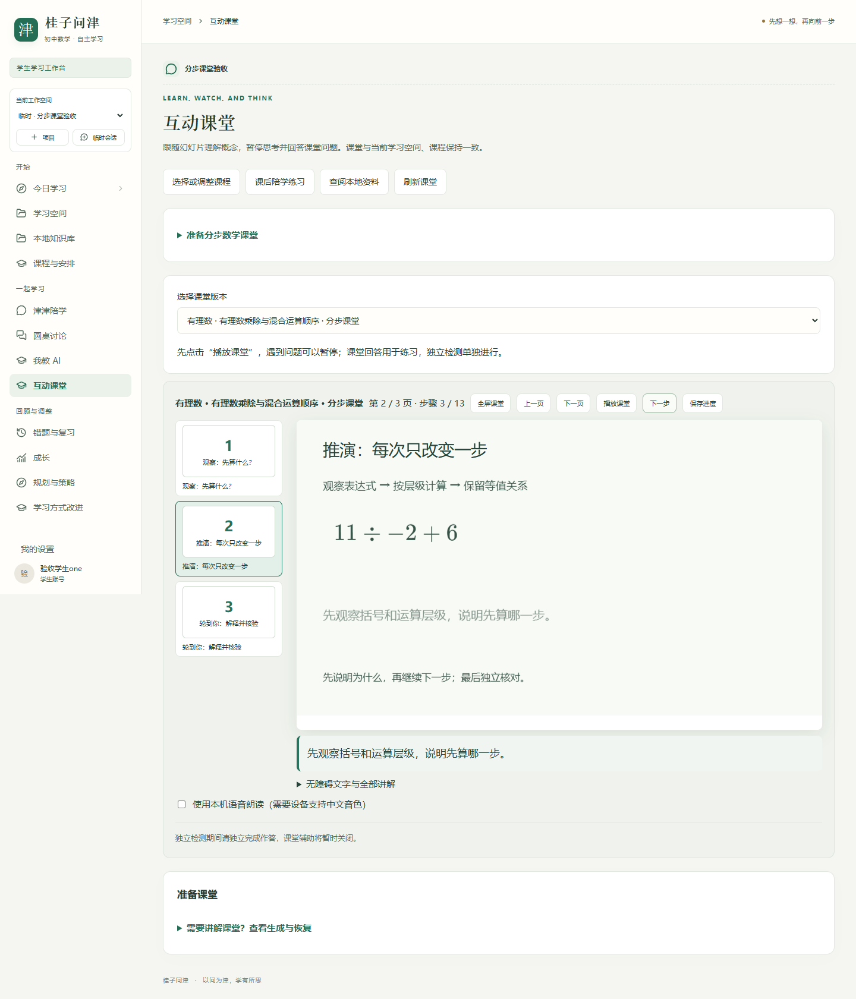
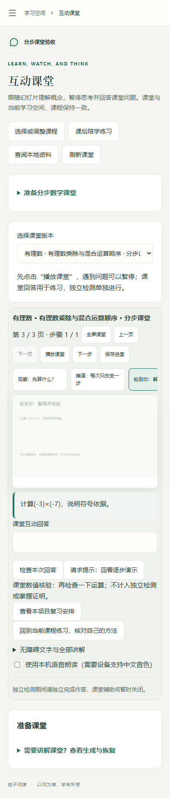

# 互动课堂重构与学生本地知识库

日期：2026-10-31。基于 `V17-20261025-debug` / `2b5232e` 开发。API `0.21.0`，数据库 `c18_001`。

## 一、这次解决什么

用户提供的课堂截图显示模型图片包含不可理解文字，五秒视频缺乏教学含义。原导入器会将富文本压成纯文本，补充媒体成为画布下的附件，自动播放又依赖文字长度。此次优先让数学内容可理解、可追溯、可核验；不以素材数量冒充教学质量。

| 工作 | 当前实施 |
| --- | --- |
| 不合格媒体隔离 | 旧生成图片与视频默认不向学生展示，直接素材地址同样门禁。保留原文件和账单；管理端逐字/全过程检查、写明教学目的后才能开放，拒绝可再次隔离。审批绑定文件SHA256。没有默认放行旧素材。 |
| 文字和公式 | 安全的富文本样式数据保留字号、粗体、斜体、颜色和对齐；不执行原HTML。正文支持显式公式分隔符。公式渲染失败有可理解的降级提示；提供完整无障碍原文。 |
| 幻灯片播放器 | 16:9画布、页面缩略入口、前后翻页、全屏、逐步显示、进度恢复；经检查媒体与画布合并成页面区域。课堂页移除重复大课程上下文。 |
| 生成与编排 | 保留OpenMAIC接入，将请求明确为目标/观察、概念推演、自我解释三场景，约束字号、密度和公式元素。另提供无费用的分步数学编译器：读取当前模型生成课程的练习题，选择可解析的例题，按表达式树编排逐步变形；不读取诊断或独立检测题。不是为所有学生写死同一数值题。 |
| 可靠数学过程 | 四则运算采用受限AST和Fraction精确运算，拒绝变量、函数、幂运算、零除和过大表达式；每一步保持等值。字体与公式通过浏览器/KaTeX绘制，不让图像模型画中文字。例题与步骤不合格就拒绝编排。 |
| 互动与同步 | 课堂题回答继续独立数值核验，可回看演示请求帮助，并进入当前项目陪学/复习。匹配讲稿的音频或本机中文朗读结束才推进；无音色用文字节奏，手动播放其他视频会暂停讲解，不同时抢跑。观看及课堂数值符合不当作掌握证明。 |
| 发布检查 | 结构检查补充越界、损坏字符、估算文字溢出。自动发布不把纯文字语义检查当作图像检查；含图片/视频的导入和存在版式疑点的课堂留待复核。 |

## 二、本地知识库

新增独立学生导航「本地知识库」。首版是**本机数据库中的项目资料检索**，不是浏览器缓存，也不是将全部学生笔记发给云模型。

- 支持手动粘贴、UTF-8 `.txt` / `.md` 导入；每份最多10万字符、每空间最多100份，文件入口最多400KB。
- 按账号所有权和项目隔离；临时会话独立。资料内容去重、按字符窗口检索，返回最多8条原文片段，携带标题、文档ID、SHA256和字符位置。
- 可查看来源全文、删除、使用现有个人数据导出。归档空间只读，独立检测期间禁止检索及阅读辅助资料；沿用CSRF和账号权限。
- 文档只作不可信参考，原文中的命令不执行；不自动成为已审核教材、数学参考答案或能力证据。当前不做模型总结，不生成没有来源的回答。
- 课堂提供查阅本地资料入口。将资料自动交给DeepSeek做RAG问答、课程规划或RSI，属于新增原文出网范围，需另确认；本轮没有扩大。

用户提供的微信文章两次读取失败，未取得正文，因此没有声称已按文章实现特定架构。若后续提供正文，可进一步对照。PDF/扫描件OCR、向量检索、跨项目共享和模型引用问答均明确未开放。

## 三、数据与运行

新增 `student_documents` 表及 `c18_001` 迁移，原课程、事实、课堂资源与媒体文件不重写。执行迁移前已停止本项目API和两个worker，并通过PostgreSQL原生pg_dump保存 `.local/before-c18-001.sql`；该文件含敏感学习数据，Git忽略且不得上传。

已有服务升级：停API/worker → 完整备份 → `python -m app.manage --env-file .local/database.env migrate` → 前端构建 → 启动API、teaching及models worker。端口保持4003。新建开发库可直接迁到最新版本。

## 四、验收

- 完整后端回归：571项通过、267项条件跳过，日志 `.local/pytest-c18-full.log`。
- 后端关键SQLite/PostgreSQL回归：初轮48项通过；最终课堂/发布门禁/媒体/隐私回归43项通过，日志 `.local/pytest-c18-final.log`。
- 类型检查、学生端/管理端构建通过，日志 `.local/classroom-build-release.log`；OpenAPI契约一致性检查通过。
- 浏览器定向回归4项通过，日志 `.local/classroom-e2e-acceptance.log`；完整浏览器51项执行中50项通过，1项因反馈改为中文和页码名称变更而触发旧断言；修正具体文案和可访问名称断言后，包含该项的3项专项复验全部通过，日志 `.local/classroom-browser-final.log`。
- 浏览器新增真实保存/检索/来源/刷新/手机流程，及主题生成→绑定→三页编排→公式渐显→互动→恢复流程；使用隔离库与FakeProvider，无真实收费调用。
- 最终新增的独立检测门禁、表达式范围收紧和媒体教学说明又单独双数据库复验：27项通过，日志 `.local/pytest-c18-last.log`。
- 对用户当前项目的已发布练习进行只读编排验证：3页、3个等值推演状态，无外部调用；没有改动原学习记录。
- 原生成测试发现同名课程造成测试定位歧义，采用唯一的测试主题隔离，未放宽功能断言。
- 本轮没有追加百炼、Tavily或DeepSeek费用，没有重开旧媒体预算。此前TTS HTTP400仍未由新的收费调用验证解决。

## 五、验收边界

分步数学课堂首轮只支持当前课程练习中的可验证有理数四则运算，不声称覆盖全部初中数学。OpenMAIC原始复杂渐变、所有富文本及动画格式不保证百分百保真，PPTX导出未实现。图像/视频的开放依赖明确人工视觉核对，尚无可证明理解整段视频教学语义的自动视觉模型管线。复杂证明、开放解释质量与真实教学效果仍未验证。

学生操作见 [19号使用说明](../使用手册/19-分步课堂与本地知识库.md)。

## 六、页面实拍

以下为隔离测试库中的自编数据，是真实React页面，不是固定HTML原型。

