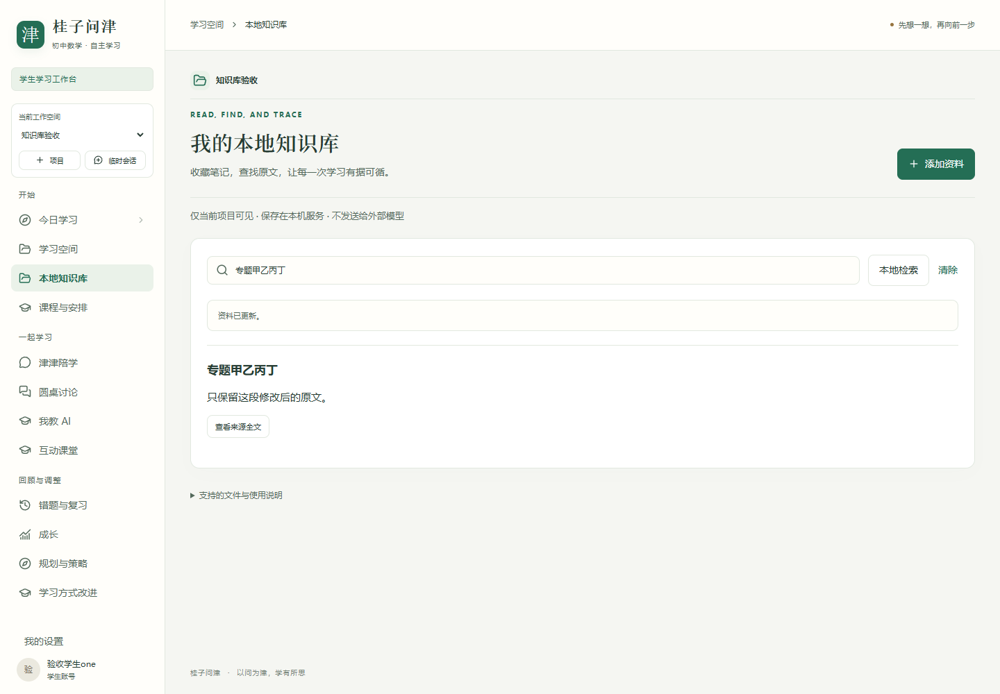
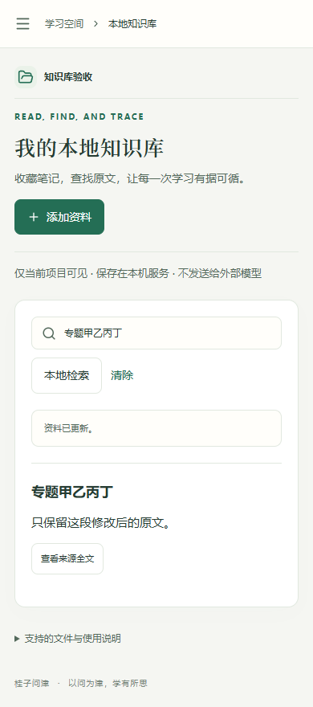

# V18 知识库体验完善

本轮落实123号评估中的首批日常体验改进。无需数据库迁移；需更新前端构建并重启API才能使用新增编辑与规划状态接口。

- 知识库采用搜索＋资料列表；添加表单按需弹出，空态提供明确入口。
- 搜索同时匹配标题和正文，每份资料返回最佳片段，支持纯符号的原文匹配。
- 阅读在对话框内打开，搜索结果定位并高亮来源片段。一般阅读支持简单Markdown标题与显式数学公式；可切换原文。不执行HTML、不加载资料中的外部嵌入。
- 支持修改标题和正文；保存时同时核对原正文hash和原标题，拒绝旧页面覆盖。编辑沿用账号、项目、归档和独立检测门禁。当前保存新内容，不提供历史版本恢复。
- 重复添加明确提示并打开已有资料；编辑成另一份已存正文会提示冲突，不静默合并。
- 陪学支持方式显示中文；未知状态也使用中文降级说明。
- 规划页预先检查模型是否开放，不可用时阻止模型提交，并提供保留表单内容的“改用手动配置”。额度和用途仍在提交时检查，不把预检当作调用承诺。

操作：本地知识库→添加资料→保存；搜索标题或正文→查看来源全文；打开资料→编辑资料→保存修改。Esc/关闭按钮离开阅读；编辑内容未保存时先确认放弃。

此次只完成首批改进，不包含PDF/OCR、向量检索、模型资料问答、完整Markdown语法、跨活动智能编排或真实教学效果验证。

验证：后端课堂/知识库/自主策略定向19通过、7个PostgreSQL条件变体跳过；前端类型检查及双端构建通过。浏览器新增标题搜索、编辑后重新读取、公式、安全来源定位和模型关闭替代路线验证，最终结果见本轮交付说明。测试使用隔离库和模拟模型。

最终浏览器覆盖5个场景：课堂、模型关闭替代路线、桌面陪学、手机陪学4项通过；知识库场景发现已有正文的隐式标签定位问题，改为显式标签关联后在原30秒时限内复验通过（9.3秒），并增加表情字符片段定位断言。没有通过延长超时掩盖该问题。新增编辑门禁/重复冲突复验1通过、1个PostgreSQL变体跳过；API生成契约检查通过。没有重跑全仓或声称本轮验证了PostgreSQL。

日志：`.local/library-polish-tests.log`、`.local/library-polish-conflict.log`、`.local/library-polish-build.log`、`.local/library-polish-browser-final.log`、`.local/library-polish-library-final.log`。

