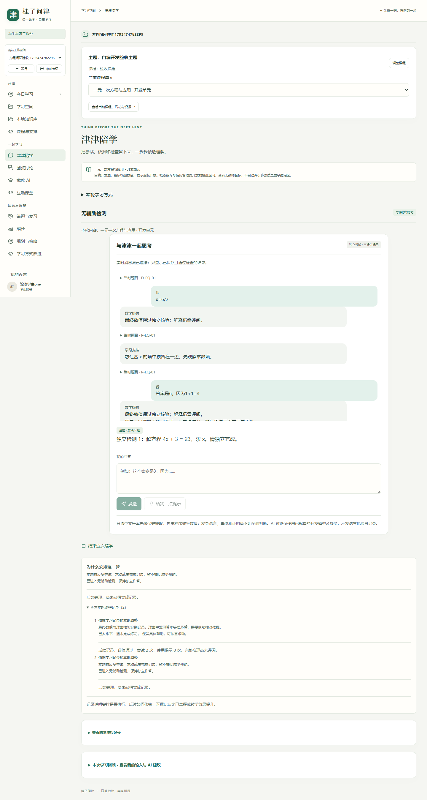
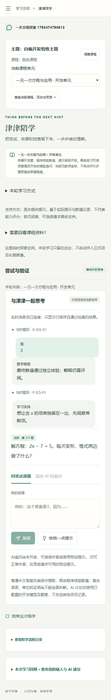

# V18 智能体闭环核查与完善

日期：2026-11-01。分支：`V18-20261026`。本轮延续123号评估、124号知识库改进，核查正式学生端使用的 `app/modules`，不把旧 CLI 原型当作已交付能力。

## 当前判断

已实现受约束的教学智能体：目标与课程上下文、模型选题和经过程序核验的变式、工具执行、持久化恢复、实际输入反馈，以及需要预授权的个人策略试用。模型建议有真实消费者，并非只有聊天文本。

尚未完整实现最初架构里的自主教学、心智世界模型和教育自进化。主流程仍由有界状态图控制；圆桌主要是同一模型的三个视角；未建立经校准的长期误区模型，也没有真实学习增益的效果验证。学生确认目标、控制收费与资料使用是合理边界，不应为了“自主”取消。

## 本轮修复

1. **减少支持的依据过宽。** 旧代码检查“曾经有一次未用提示的数值通过”，会忽略最近的反复尝试和理由矛盾。现在本地支持策略和模型请求共用观察规则：检查最近练习是否首次通过、是否使用提示、是否发现显式算术矛盾，并服从个人的逐级支持策略。数值、算术等式一致性与完整解释评阅仍分别处理，不把数值通过当作理解掌握。
2. **模型建议与执行时证据可能不一致。** 在反思提交后的实际执行处再核对最终表现；需要帮助时覆盖旧的渐撤建议。检查建议所属账号、空间、课程版本、目标修订和请求完整性；失效建议不再改变任务，改用本地规则继续学习。
3. **模型未开放时缺乏明确的调整记录。** 增加不调用外部服务的本地控制器，根据本题实际记录选择维持、渐撤或恢复支持；对有理数课程选择已有审核问句的依据、表示或核验方向。它不新增收费、不跳过原练习、不替换独立检测。
4. **只有安排，缺少结果回收。** 新增持久教学调整轨迹，区分来源、观察、建议、实际下一题与阶段、支持是否应用、后续作答结果。后续记录包括尝试次数、提示次数、算术核验状态和反思。刷新与重建 worker 后继续恢复；重复提交不会重复创建轨迹。记录结果不等于证明教学干预有效。
5. **界面缺乏可读解释。** 陪学增加“为什么安排这一步”，默认说明最近调整，历史按需展开；区分“尚无后续记录”“流程停止”“进入独立检测”，资源阅读建议继续明确为未确认执行。历史对话保留算术矛盾提示，不再只显示数值通过。

主要实现：`app/modules/learning/teaching_loop.py`、`tutor_graph.py`、`tutor_service.py`、`tutor_history.py`、`app/modules/generation/interaction.py`；界面为 `frontend/apps/student/src/teaching-trace.tsx` 与陪学对话页。

兼容方式：新增状态存入已有检查点和视图 JSON，无需数据库迁移；旧记录未保存的推理状态默认“未评阅”，不回填推测。已有运行继续操作后才产生新调整轨迹，历史不会凭空补造。新增字段同步生成API类型。

## 验证

- 最终合并后端回归：**137通过，53跳过**。跳过项为未启用的 PostgreSQL 条件变体，不代表本轮验证了 PostgreSQL。
- 覆盖相同数值不同理由、反复尝试覆盖模型渐撤、个人逐级支持、变式执行与来源、旧目标/旧内容/请求变动拦截、刷新恢复、重复提交、账号隔离、检测无提示及原有模型运行测试。
- 前端类型检查与学生端/管理端构建通过，API契约生成检查通过。
- Edge 浏览器：桌面完整学习闭环与手机隔离/取消 **2通过**。桌面实际完成错误理由提交、恢复支持、刷新、后续作答与反馈回收、独立检测及小结，并核对历史提示。
- 初次浏览器尝试缺少 Playwright 独立 Chromium，未执行页面测试；改用本机 Edge 后通过。受限环境 Python 测试启动无输出，停止后以本机权限运行隔离测试成功。测试使用临时 SQLite 和模拟模型，没有调用真实收费模型。
- 日志：`.local/agent-loop-complete.log`、`.local/agent-loop-build.log`、`.local/agent-loop-browser-final.log`。

## 仍需改进及验收方向

| 优先级 | 当前缺口 | 下一步及验收 |
| --- | --- | --- |
| P1 | 资源建议尚未形成执行闭环 | 绑定具体审核资源，记录打开、退出和自我解释；区分打开与读懂。建议不得永久占据“下一步”。 |
| P1 | 陪学、课堂、圆桌、我教AI、复习之间主要由学生切换 | 建立统一可取消待办与返回当前任务机制；根据已授权范围选择活动，记录完成/跳过及回到原目标的结果，禁止只更新一段建议文字。 |
| P1 | 数值以外的理解证据有限 | 先针对一个知识点建立教师认可的误区假设及诊断题，明确“证据不足”；区分算错、猜对、有效解释。不能将本轮算术等式检查包装成完整推理验证。 |
| P2 | 长期记忆尚非经校准的学习者模型 | 将同版本、首次曝光、辅助使用及来源串联为可解释观察，再用独立数据验证预测；不要直接展示未经验证的掌握概率。 |
| P2 | 个人策略试用尚无真实教学收益证据 | 增加等值未见题、延迟与迁移测验、撤回条件；比较无辅助表现及支持使用，不能把测试通过或数值通过率当作因果收益。 |
| P2 | 本地知识库仍与当前题分离 | 在学习旁提供可返回当前题的本地检索入口和保存笔记；以后若增加模型引用，明确所选资料范围与可点击原文来源。 |
| P2 | 页面顶端课程信息与多处说明占用较多空间 | 进一步折叠已确认课程细节，优先呈现当前题、一个主动作和按需说明；保留手机布局与键盘操作验证。 |
| 后续 | 课程覆盖与圆桌自主性有限 | 先完善知识点—题族—核验器—专业审核矩阵；确有需求后再引入独立角色工具与冲突核验，不能把多角色文案称为独立委员会。 |

本轮不实现任意目标规划、自动跨活动工具调用、完整证明判分或全局自动策略发布。上述项目是明确剩余工作。

