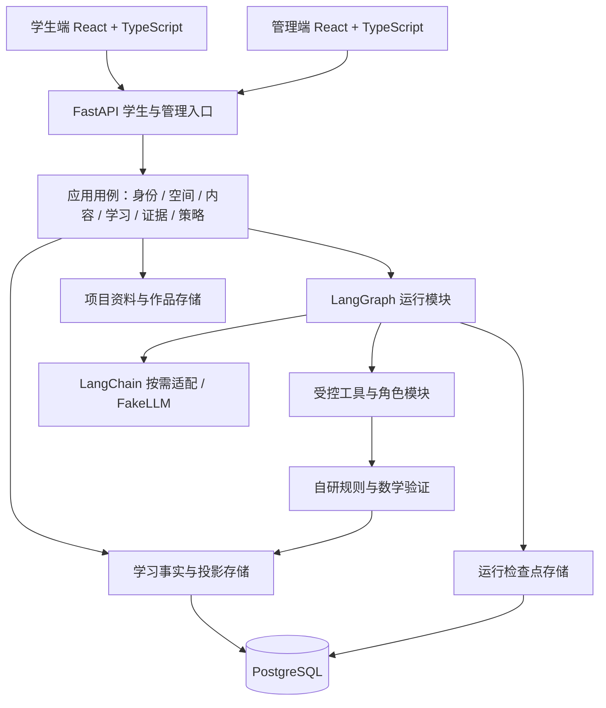

# 桂子问津工程架构与分步实施规划

版本 v0.1，2026-10-15。本轮完成代码位置整理与架构规划，不改业务实现，不接通模型，不创建 React 工程或新增框架依赖。

## 1 已确认的开发决策

| 事项 | 本轮确认与实施依据 |
|---|---|
| 产品范围 | 初中七至九年级常见数学单元，以学生自主学习为主，本地或内网试点 |
| 内容与数据 | 按课标知识点组织；先建自编开发题库；允许指定外部模型 API；真实效果需要后续真实学习者验证 |
| 前端设计 | 沿用已完成的学生端和管理端 HTML 原型，按真实功能补全状态与细节 |
| 正式前端技术 | **React + TypeScript**，负责人于本轮确认；建议以 Vite 建立两个独立应用，共享基础组件 |
| 智能体框架 | **LangGraph 负责流程编排，LangChain 按需承担模型与工具适配**，负责人于本轮确认 |
| 教育内核 | 动作语法、硬约束、提示阶梯、数学验证、学习者模型和证据规则继续按本项目契约实现 |
| 代码位置 | 交接包中原 `platform/` 的内容直接平移到仓库根目录，保留内部包名与相对层级 |
| 基准文档 | 原有 `docs` 文件保持原状；本文记录新增决策。此前 10、12 号文档中的零构建/原生前端选择，由本轮 React + TypeScript 决策更新 |

本文是接下来编码的路线图。目录中标为“目标结构”的新增部分尚未创建，接口形态是设计约定，具体字段在对应阶段细化。不得把规划表中的条目视为已完成能力。

## 2 本轮文件整理结果

迁移前逐文件计算 SHA-256，迁移后核对 60 个文件内容一致。移动范围包括源码、测试、依赖锁、题库、初版前端、截图与演示工作区。没有读取其他分支，没有修改 Python、测试或 HTML 源文件。

| 原路径 | 当前路径 | 处理 |
|---|---|---|
| `桂子问津_交接包/platform/app/` | `app/` | 平移，保留导入包名 `app` |
| `…/platform/evolution/` | `evolution/` | 保留 L0 沉淀演示 |
| `…/platform/tests/` | `tests/` | 保留现有回归用例 |
| `…/platform/seeds/` | `seeds/` | 保留初中数学题库雏形 |
| `…/platform/web/` | `web/` | 保留初版页面、历史原型及截图，供原网关继续定位 |
| `…/platform/workspace/` | `workspace/` | 保留演示学习文件，尚未升级为项目隔离工作区 |
| `…/platform/pyproject.toml`、`uv.lock`、`.env.example` | 根目录同名文件 | 平移，不更新依赖 |
| `…/platform/README.md` | `README.legacy.md` | 原文保留，避免覆盖仓库总说明 |
| `桂子问津_交接包/docs/` | 原先已整理到 `docs/` | 本轮该目录为空，仅移除空目录 |
| `桂子问津_交接包/` | 已移除 | 有用文件全部保留后清除空容器 |

`Settings.load()`、题库定位和旧前端定位均以包文件的相对层级计算。将 `app`、`seeds`、`web` 等整体平移后，这些层级保持一致；相对工作目录的数据路径改为从根目录启动时解析。实际运行正确性仍要在 S01 建立依赖环境后重跑确认。

原文档和 `README.legacy.md` 中的 `platform/`、`../docs/` 等旧引用属于历史目录视图。请用本表定位，不据此恢复交接包目录。新版启动命令见[仓库 README](../../README.md)。

## 3 对现有代码的判断

现有代码提供教学机制雏形，但需要分步工程化后才能支撑新原型的完整功能。

| 现有位置 | 可复用内容 | 需要演进的部分 |
|---|---|---|
| `app/core/` | 状态 Schema、动作信封、Governor、提示/5E 状态机 | 核对每条规则的真实覆盖；补项目、来源与版本上下文；避免依赖框架类型 |
| `app/orchestration/` | Trigger、策略选择、会话步骤 | 将大段会话逻辑逐步放到清晰的应用用例和图节点后面，保持教学行为回归 |
| `app/agent/` | 工具门面、计划/反思/升级关口、转录、学习文件 | 生成器与进程内状态需升级为可持久恢复的运行状态；文件隔离需加入项目 |
| `app/agents/templates.py` | 怀疑者与结构化产物雏形 | 扩展为有预算、最小上下文、验证与退出条件的多角色实现 |
| `app/learning/` | 数学验证、BKT、路径建议与证据聚合 | 适配分层题型、版本化内容和可追溯证据；保留无法验证结果 |
| `app/gateway/routes.py` | FastAPI 入口与既有契约 | 当前会话依赖内存字典，缺独立身份/项目授权，需按学生与管理职责拆分 |
| `app/storage/db.py` | SQLite 存储与事件/快照写入 | 迁移 PostgreSQL，补外键、事务、去重、权限与恢复，区分事实与投影 |
| `app/llm/` | Provider 接口、兼容客户端、FakeLLM | 保留替换点，引入 LangChain 适配；以能力标记代替按类名判断 Provider |
| `web/` 与 `prototypes/` | 历史页面与当前双端交互基准 | 将选定原型迁成 React 双端，显式替换静态数据与本地模板逻辑 |

现有“61 个测试通过”是交接时的历史记录，不等于本轮已重跑。框架接入也不自动保证数学正确、规则不可绕过、项目隔离或学习效果，仍须验收。

## 4 整体架构建议

采用一个后端内按职责组织的模块化应用。开发与试点先部署 API、运行 worker 和 PostgreSQL；通过模块 Interface 保留未来拆分空间。前端是两个独立构建入口，后端用同一业务内核提供学生与管理能力。



### 4.1 目标目录

```text
EduAgent/
├── app/                         # 后端 Python 包，当前位置不再改变
│   ├── main.py / cli.py / config.py
│   ├── bootstrap.py             # 目标：统一装配配置、依赖与运行入口
│   ├── core/                    # 教学契约与确定性规则，先保留现有实现
│   ├── gateway/                 # HTTP/SSE，学生与管理路由分别组织
│   │   ├── routes.py            # 现有入口，迁移期保持兼容
│   │   ├── student/             # 目标：学生身份和项目用例
│   │   └── admin/               # 目标：审核、运行与策略管理
│   ├── modules/                 # 目标：按业务职责组织的深模块
│   │   ├── identity/            # 身份、角色、数据授权
│   │   ├── workspaces/          # 正式项目、临时会话、归档与成员权限
│   │   ├── curriculum/          # KC、先修、题目版本、资源与审核
│   │   ├── learning/            # 目标、计划、练习、检测、反思与复习
│   │   ├── evidence/            # 画像、证据链、全局/局部展示与纠正
│   │   └── strategies/          # EvidenceBundle、Skill/Harness、评审与发布
│   ├── runtime/                 # 目标：框架集成集中在此
│   │   ├── graphs/              # 陪学、圆桌、我教 AI、规划子图
│   │   ├── context/             # 授权后的项目切片与课程检索
│   │   ├── tools/               # 动作映射、预算与工具执行门
│   │   └── state.py             # 可恢复运行状态，引用业务 ID
│   ├── infrastructure/          # 目标：技术 Adapter
│   │   ├── db/                  # ORM、Repository、事务与 outbox
│   │   ├── models/              # LangChain Provider / 旧接口适配 / Fake
│   │   ├── files/               # 本地文件存储，后续可换对象存储
│   │   └── jobs/                # 持久任务、租约、重试与清理
│   ├── agent/ / agents/         # 已有实现，逐模块迁移，不一次搬空
│   └── orchestration/ / learning/ / storage/ / llm/
│                                # 现有位置，迁移期可作兼容门面
├── frontend/                    # 目标：React + TypeScript 工程
│   ├── apps/student/            # 独立入口与学生路由
│   ├── apps/admin/              # 独立入口与管理路由
│   └── packages/                # 共用 UI、数学显示、请求契约
│       ├── ui/                  # 视觉 token、表单、弹窗、布局与无障碍
│       ├── math/                # 公式、函数/几何画布与证据图表
│       └── api-client/          # OpenAPI 类型、请求与事件流适配
├── migrations/                  # 目标：Alembic 结构迁移
├── evaluation/                  # 目标：场景、数据构造与回归运行器
├── tests/                       # 保留原回归，逐步按领域组织
├── seeds/                       # 开发题库与基础字典，保留来源版本
├── evolution/                   # 保留现有 L0，未来按原里程碑接入
├── web/                         # 当前旧网关的前端资源，暂时保留
├── workspace/                   # 当前演示文件，未来经存储模块管理
├── prototypes/                  # 当前双端设计基准，独立于正式前端
├── docs/                        # 原有基准 + 新增实施文档
├── pyproject.toml / uv.lock / .env.example
└── README.md / README.legacy.md
```

`frontend`、`modules`、`runtime`、`infrastructure` 等是目标目录，随着负责的功能出现再建立。`learning` 等名称从旧目录转入模块时，先明确唯一的规则实现和调用入口，再保留必要的兼容导入。不要同时维护两套有效的提示阶梯、计划确认或知识追踪逻辑。

### 4.2 模块 Interface 与依赖纪律

| 模块 | 调用者应看到的小 Interface | 隐藏的 Implementation |
|---|---|---|
| Workspace | `create / open / archive`，返回经授权的 Scope | 所有权检查、临时/正式生命周期、文件隔离 |
| Learning | `submit / confirm / resume`，返回运行 ID、版本或结果 | 诊断、计划、作答、检测与复习规则 |
| AgentRuntime | `start / resume / cancel / events` | 图结构、检查点、预算、Provider 调用与重试 |
| MathVerifier | `verify(题目版本, 学生产物, 条件)` → Verdict | 各题型验证、定义域、超时、rubric、人工复核分流 |
| Evidence | `query(scope) / explain(judgment) / correct` | L1/L2/L3 来源、投影、全局汇总、不确定性与纠正 |
| Strategy | `propose / evaluate / review / activate / rollback` | 版本谱系、评审资格、学生确认、发布门禁 |

这些是职责层面的 Interface，不直接规定实现为多个类。只为确实变化的依赖建立 Seam：例如 Fake/真实模型、SQLite/PostgreSQL、本地/对象存储。避免给每个函数都套一层无行为的包装。

HTTP 入口负责请求校验和调用，不直接驱动数据库细节或拼接模型提示词；图节点调用业务模块，不绕过它们写事实；教育内核不导入 FastAPI、LangGraph 或具体 ORM。外部模块通过公开 Interface 使用功能，减少跨目录读取内部字段。

## 5 LangChain、LangGraph 与自研部分的分工

### 5.1 为什么本次引入

现有 `LearningAgent` 已包含一个自研智能体循环：硬阶段控制、模型选工具、工具门禁、暂停等人。它适合证明教学机制，但多用户场景还需要重启恢复、多个图流程、人工审核关口和运行追踪。

LangGraph 提供显式流程及运行恢复能力；LangChain 提供模型/工具适配和通用 Agent 组件。负责人已确认用两者组合承载这些工程职责，同时保留本项目的教育契约。[官方框架分层说明](https://www.langchain.com/oss-overview)及 [LangChain 概览](https://docs.langchain.com/oss/python/langchain/overview)支持按控制粒度选择组合。

### 5.2 职责表

| 能力 | 采用方式 | 本项目仍须实现 |
|---|---|---|
| 多轮与多角色流程 | LangGraph 定义状态、节点、分支与子图 | 教学阶段、允许的角色、预算、结束与升级条件 |
| 等学生/教师输入 | LangGraph interrupt 配合持久检查点 | 有权审批者、表单 Schema、时效、版本匹配与撤回 |
| 模型连接 | 按需用 LangChain Provider/结构化输出适配，保留 FakeLLM | 指定模型能力校验、课程提示、超时、成本、日志与数据范围 |
| 工具调用 | 映射到受控工具注册表 | 调用前授权和 Governor、参数白名单、数学检查、审计 |
| 运行恢复 | PostgreSQL-backed checkpointer | 图版本映射、线程归属、幂等、副作用恢复与取消语义 |
| 课程检索 | 首先按 KC 和审核内容检索，必要时接检索 Adapter | 题目版本、知识点接地、引用和内容审核；既有 RAG 方向单独落地 |
| 学习者记忆 | 业务事件、摘要与画像负责长期事实 | 框架对话历史不等于学习模型；L3 判断仍需可追溯来源 |
| 可观测性 | 先记录本地运行与步骤 ID | 若使用外部观测平台，另确认数据出网与脱敏范围；不默认开启外部追踪 |

LangGraph 的 [interrupt 文档](https://docs.langchain.com/oss/python/langgraph/interrupts)说明恢复需要稳定线程标识与检查点；恢复时节点可能从头执行。因此节点内的写入和工具调用需要幂等处理，不能把“框架能恢复”当作副作用恰好执行一次。

框架[持久化文档](https://docs.langchain.com/oss/python/langgraph/persistence)区分线程检查点与跨线程存储。本项目将检查点用于恢复，长期学习事实仍使用自己的事件与快照模型。[Python 参考](https://reference.langchain.com/python/langgraph/overview)列出了 PostgreSQL 检查点等适配包；首次接入时固定兼容版本，再细化 API 调用，不直接依赖未锁版本的在线示例。

### 5.3 初期四个图

1. **TutorGraph**：准备上下文 → 诊断/选择任务 → 等学生尝试 → 生成动作提案 → Governor → 验证或受控提示 → 记录 → 反思/检测 → 下一任务或结束。
2. **RoundtableGraph**：明确问题 → 注入角色切片 → 举例/质疑/总结 → 学生贡献 → 对抗核查 → 有条件结论或保留分歧。首版有限轮次和角色数，逐步增加复杂协作。
3. **TeachGraph**：加载公开误区 → 学生解释 → 角色追问/迁移任务 → 验证与 rubric → TeachReport。错误示范明确标记，不能进入正确知识库。
4. **PlanningGraph**：收集 EvidenceBundle → 标记来源/冲突 → 提案计划与软策略 → 回归检查 → 人工审核暂停 → 学生确认暂停 → 版本化激活或退回。

三个教学图共享 Governor、验证器、内容库与证据模块，不能各自实现一份“防直接给答案”。规划图不拥有修改硬约束、任意文件或模型权重的工具。

## 6 数据、运行状态与交互的具体设计

### 6.1 三类状态分开管理

| 状态 | 存储与用途 | 不得混淆的事项 |
|---|---|---|
| 学习事实 | 用户作答、教学动作、验证、反思、授权与人工纠正，按业务事件追加 | 可作为证据来源；纠错保留原过程与补偿记录 |
| 学习投影 | 当前掌握、复习队列、L2 摘要、全局/局部证据视图 | 带来源和版本，可从事实再生；不能自我引用成新事实 |
| 运行检查点 | LangGraph 执行位置、待输入关口、临时结果和工具状态 | 用于恢复，不直接当成掌握证据或真实学生数据 |

关系实体、权限、当前配置和框架检查点可按职责更新；“只追加”约束适用于已定义的学习事实与快照，不机械套用到所有数据库表。授权撤回、匿名化和受控删除继续走独立治理流程。

### 6.2 Scope 和标识

每次业务请求由已认证身份生成 Scope，至少含 `learner_id`、`workspace_id`、`workspace_kind`、`project_id`（临时空间为空）、目的范围与版本上下文。用户不能通过替换请求中的 `learner_id` 访问其他人记录。

`thread_id` 由服务端映射到 workspace、conversation、graph 和运行实例；不能只用 learner ID，也不能把 thread ID 当访问凭证。正式项目和临时会话的运行空间、文件与投影分别授权。临时数据默认不进入正式画像与晋升素材；正式项目归档不自动抹去纵向历史。

每轮包含 `request_id`、`run_id`、`conversation_id`、`sequence_no`、内容/规则/策略版本和 `source_kind`。恢复请求还须携带待处理关口及预期 revision，服务端重新检查审批者、当前授权、规则和版本。

### 6.3 一次提交到结果的路径

1. 身份与 Scope 校验，检查重复提交、会话状态和当前内容版本。
2. 事务内保存已接受的学生输入、事件和待运行任务/outbox，返回请求与运行 ID。
3. worker 按租约取得任务，以服务端绑定的 thread 启动或恢复图；从业务模块读取授权切片。
4. 模型只产出提案；受控工具调用在执行前重新做授权、预算与 Governor 裁决。
5. 可验证内容经数学验证与输出规则检查。SSE 可先发进度、工具状态与待输入关口；学生可见文本通过检查后再发送，避免原始模型 token 提前泄漏答案。
6. 幂等保存动作、工具结果、Verdict 与证据引用，再更新投影。框架随后保存检查点；中间失败可重放与对账。
7. 断网后查询运行状态或续传事件；取消只停止后续工作，不撤销已确认保存的作答。

PostgreSQL 业务事务与框架检查点不假定自动形成一个原子事务。用业务唯一键、幂等工具结果、outbox 和恢复对账解决“已执行但检查点未保存”等情况。重复投递不得重复计分、再升级提示或二次激活策略。

## 7 React 双端如何沿用现有页面

学生端与管理端使用独立入口、路由树和构建输出，例如部署为 `/student/` 与 `/admin/`；可共享 UI 与数学显示实现。前端隐藏按钮只改善体验，真正访问限制由后端角色和 Scope 保证。

建议使用 Vite 的 React + TypeScript 工程。Vite [官方入门](https://vite.dev/guide/)提供 `react-ts` 模板，[生产构建说明](https://vite.dev/guide/build.html)说明静态输出与路径配置；具体 Node、包管理器和插件版本在 S01/S03 建环境时锁定。本轮不安装或生成模板。

迁移时先提取墨绿/纸面视觉 token、布局、表单、弹窗、数学画布与图表，再按功能拆模块。保留现有项目选择、临时路线、圆桌、我教 AI、全局/局部证据与规划评审交互，必要调整围绕真实空态、错误、恢复和权限状态进行。

演示中的全局 JavaScript `state` 不直接搬成一个大 React 状态对象。项目/页面 UI 状态与服务端事实分开；项目缓存键含 workspace/project，切换时不得显示上一项目的结果。API 类型从 FastAPI OpenAPI 生成或校验，SSE 再定义明确事件联合类型。

文件导出回执是原型的双端交接演示，正式 React 接入时改为真实评审接口与服务端状态，不能把可编辑 JSON 当作认证结果。浏览器不保存模型密钥；外部 API 由后端 Provider Adapter 调用。

## 8 分阶段实施计划

每阶段都要有用户可见功能、实现落点和完成条件。下表是依赖顺序，可在内部并行准备内容与页面，但后一阶段不能假定前置能力已完成。

| 阶段 | 完成什么功能 | 具体实现方式 | 实现目标与验收 |
|---|---|---|---|
| **S00 整理与定方向（本轮）** | 根目录工程、框架和前端方向 | 原文件平移；保留历史说明；新增本文 | 60 文件哈希一致；原容器移除；原有 docs 不改；业务代码不改 |
| **S01 可复现基线与契约** | 能从根目录运行原工程和回归；明确新增接口 | 配置 Python 开发环境；复跑现有测试；列出 API/数据缺口；固定工具版本和版本策略 | 记录真实测试结果；FakeLLM 零外部调用；验证根目录资源路径、安装包资源及启动方式；新 API/事件 Schema 可评审 |
| **S02 身份、空间与持久化** | 独立角色、项目与临时会话、归档恢复、记录隔离 | SQLAlchemy/Alembic + PostgreSQL；Scope；会话/输入事件/投影/outbox；SQLite 迁移脚本 | 不同用户/项目不能越权；临时会话不入画像；重启可恢复已接收输入；迁移核对与备份恢复通过 |
| **S03 React 双端工程化** | 以现有风格交付两个真实前端入口和项目操作 | 独立 student/admin app；共享 UI/math；生成类型；登录/项目接口；加载/错误/空态 | 原型主要布局保真；学生无管理路由入口；真实创建/切换/归档项目；刷新不丢项目状态；窄屏与键盘操作通过 |
| **S04 框架运行骨架与恢复关口** | LangGraph 可开始、暂停、恢复、取消；模型可切换 | Runtime Interface；Postgres checkpointer；LangChain Provider Adapter/Fake；工具门禁；先跑最小计划确认图 | 服务重启后仍等待正确学生/审核者；重复 resume 不重复执行；错误项目/thread 拒绝；图版本和业务事件可追踪 |
| **S05 第一条数学学习闭环** | 方程与应用：诊断、计划、作答、逐级提示、反思、无辅助检测 | 复用 schema/rules/machines/verifier；TutorGraph；审核内容版本；学生确认与 SSE | React 实际走通整单元；R-01/R-02/R-09 等场景通过；非标准正确解可处理；失败/未知转待复核，不伪造成功 |
| **S06 错题、复习与长期记忆** | 项目错题、本地/全局证据来源、复习与画像纠正 | 学习事实 → L2 小结 → L3 模型；证据链接；BKT/受控学习引擎适配；复习排程 | 切换项目不串记录；L3 能追溯 L1/L2，禁止 L3 引用 L3；默认调度参数标明；修正不覆盖历史 |
| **S07 圆桌与我教 AI** | 当前项目内真实角色交互、学生贡献、核查结论、TeachReport | 有限轮 RoundtableGraph/TeachGraph；模板/误区/最小上下文；统一 Governor；验证与人工分流 | 角色发言与最终结论区分；关键结论过核查；考试隔离；不同项目记录独立；解释质量需依据 rubric，不仅匹配关键词 |
| **S08 成长证据与素养展示** | 全局宏观/项目局部、独立检测和提示走势、素养与来源钻取 | Evidence 模块与读模型；审核 rubric；自述、观察、估计、实测分开；不确定性与缺失态 | 全局排除临时空间；项目局部可对账；没有证据不画假分数；雷达逐渐替换示意刻度，交互量不直接当能力 |
| **S09 规划 Agent 与 Skill/Harness 治理** | 输入学习证据和课程材料，形成可评审、可激活、可回滚策略 | EvidenceBundle；PlanningGraph；受限软策略 Schema；评测记录；审核角色；学生确认；不可变版本与激活指针 | 来源/教材版本可追溯；资料不能覆盖系统指令；拒绝/退回/失效版本可处理；重复激活幂等；回滚保留谱系 |
| **S10 三年级内容包扩展与管理完善** | 数与式、函数、几何、统计概率逐单元真实可用 | 同一任务/验证协议；各领域 Adapter；题库、提示与审核队列；平行检测与先修图 | 每单元有审核题目、答案、提示、误区、验证和独立检测；几何证明保留人工出口；章节入口不等于完成覆盖 |
| **S11 内网试点准备与真实验证** | 部署、监测、数据管理、人工支持与小范围真实试点 | API/worker/Postgres 部署；限制日志与访问；备份/恢复；目标硬件压测；授权与导出；内容责任确认 | 冻结核心场景与红队门通过；已交付内容可复核；真实与模拟来源分离；建立真实基线，按原条件评审后续 RSI |

S05 的最小内容审核能力与 S02 的管理权限需要先到位；S10 是扩展和完善，不意味着此前题目可绕过审核。S07/S08 的 UI 可先接结构化过程记录，不能因 rubric 尚未确定就自动生成素养分数。

### 8.1 每阶段的共同交付

- 页面、业务用例、Interface/事件、数据迁移和验收场景能互相对应。
- 教学规则或 Schema 改动补行为验收；低影响布局调整用浏览器检查。原回归保留为迁移基线，不以测试数量代替覆盖。
- 必须说明哪些是真实实现、哪些仍为 Fake/模拟数据，以及需要人工确认的事项。
- 路径/版本/部署变化新增迁移说明，业务事实不能因重构丢失。

### 8.2 前期数据与评测并行线

从 S01 开始建立确定性脚本和参数化误区场景；S05 首次闭环时至少完成既有计划中的 30 个核心多轮场景，再向 100 场景扩展。数量是工程覆盖目标，需要同时覆盖角色、规则、来源、任务类型与恢复异常。

数学真值由自编内容、程序验证和人工审核构成；LLM 学生用于找交互问题，不能既产生行为又作为唯一评价裁判。模拟数据、成人体验与真实学生来源分开。模拟场景数量不能计入真实活跃学生、教师金标或 RSI 点火条件。

## 9 编码前后必须遵守的迁移方法

现有 `LearningAgent` 与 `TutorSession` 是行为基线。先经 Runtime Interface 包装旧实现，再将选定学习流程逐节点接入 LangGraph；每次切换核对任务推进、提示放行、事件与反思结果。确认调用者已切换后，再清除被替代的旧 Implementation。

Provider 接入先用 Fake 和结构化记录验证模型/工具能力，再接指定端点。数据库迁移先落事件和学习者模型，再扩展内容与治理。React 先完成双端骨架和数据状态，再按 S05–S09 接入每条学习路线，逐步移除对应演示模板。

当前 `web/index.html` 仍供旧 FastAPI 根入口使用，本轮没有将它替换成新原型。React 上线前再明确新路由和旧页面的保留/退役方式，验证后才移动旧静态资源。`workspace/demo_student_001` 保留为开发示例，不能默认导入真实学习者空间。

## 10 仍需在对应阶段请负责人确认

以下不阻碍本轮整理与规划，不能在实现中悄悄假定：

| 确认点 | 最迟在哪一步确认 | 为什么需要 |
|---|---|---|
| 指定外部模型服务商、端点、型号与预算 | S04 接真实 Provider 前 | 已允许指定 API，但未选定具体服务；不同能力影响工具/结构化输出适配 |
| 首期账户来源和管理员初始化方式 | S02 身份实现前 | 内网自建账户、邀请码或学校身份源的实现不同；管理端不能默认开放 |
| 试点硬件、并发预期与浏览器范围 | S03 工具链锁定及 S11 性能门前 | 影响构建兼容、流式体验与部署配置；不能沿用单次模型耗时作为承诺 |
| 数学内容审核责任与首批试点单元 | S05 面向真实学习者发布前 | 当前先建自编开发题库，不等于所有题目已获专业审核 |
| 素养 rubric、展示口径与量表校准 | S08 真实赋值前 | 原型六维图是观察界面，不是已验证的测量工具 |
| 外部追踪/对象存储等新增服务与数据范围 | 实际引入前 | 已授权模型调用不等于授权把完整学习记录传给所有外部服务 |

本轮已确认的 React + TypeScript、LangGraph + 按需 LangChain 不再作为待选项重复询问。后续仅在出现新的实质约束或方向变化时重新评审。
